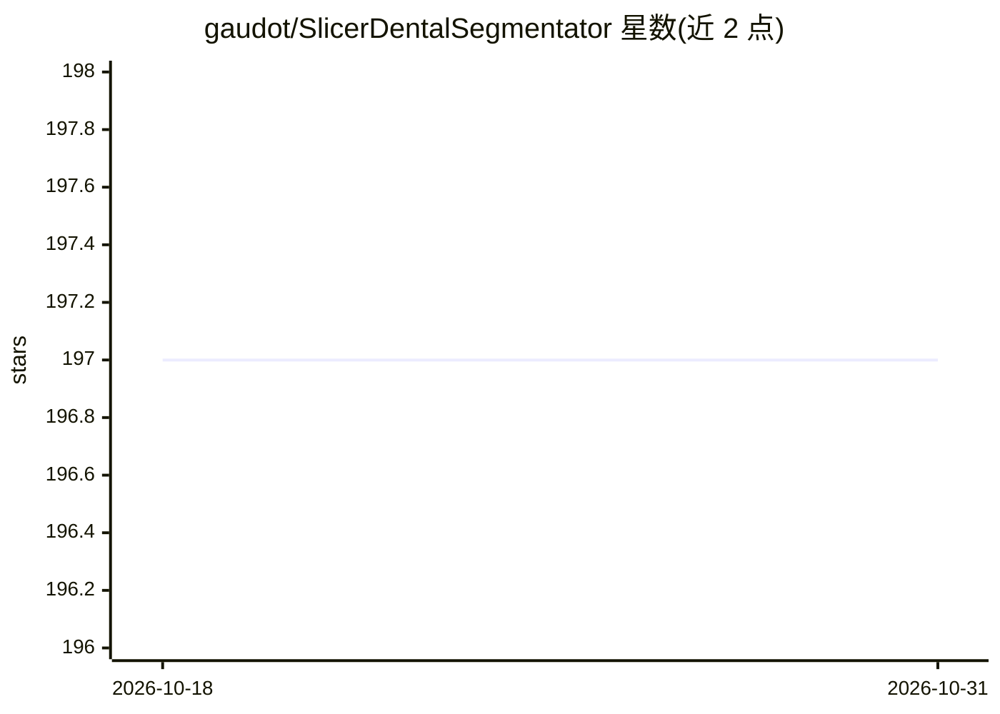

# gaudot/SlicerDentalSegmentator

⭐ 197 · Python · NOASSERTION · 推送 2026-05-22 · [GitHub](https://github.com/gaudot/SlicerDentalSegmentator) · 组织维护

**3D Slicer 扩展：CT/CBCT 牙科体数据全自动分割**

面向 3D Slicer 平台的医学影像扩展，加载 CT 或 CBCT 牙科体数据后一键生成上颌骨与颅骨上部、下颌骨、上下牙列及下颌管的自动分割。底层模型 DentalSegmentator 基于 nnU-Net 框架，在 470 例牙颌面 CT/CBCT 上训练，并在 7 家机构 256 例数据上评估。首次运行时自动安装模型权重、PyTorch、nnUNet V2 等依赖；无 CUDA 设备处理耗时较长，Linux 上建议 32 GB 内存，macOS 暂无 GPU 加速。分割结果可在 Segment Editor 中编辑并导出，另提供 Zenodo 上的预训练模型供 nnU-Net 命令行使用。

## 筛选速览

| 维度 | 判定 | 备注 |
|---|---|---|
| AI 角色 | `ai-native` | 本体是模型或模型工具 |
| 许可风险 | `none` | NOASSERTION |
| 部署形态 | `desktop` | 安装包/桌面程序 |
| 模型依赖 | — | README 未给出锁定关系 |
| 硬件要求 | — | 无带数字的原话,不猜 |
| 安装摩擦 | `medium` | 含编译或系统依赖之一 |
| 成熟度 | — | 结构信号不足 |

## 能力要点

- 基于 nnU-Net 的模型，470 例训练、256 例多机构测试评估
- 生成 5 类分割：上颌骨与颅骨上部、下颌骨、上下牙列、下颌管
- 通过 3D Slicer 扩展管理器安装，首次启动自动下载依赖与权重
- 预训练模型发布于 Zenodo，可经 nnU-Net 命令行使用

## 适用场景

- 牙科 CT/CBCT 影像中自动分割颌骨与牙齿结构
- 口腔正畸或种植手术规划前的解剖结构提取
- 在 3D Slicer 内对分割结果进一步编辑与导出

## 场景标签

`目标检测` · 领域:感知与多模态

## 证据(README 行号)

> L3: 3D Slicer extension for fully-automatic segmentation of CT and CBCT dental volumes.
> L14: DentalSegmentator is based on nnU-Net framework. It has been trained on 470 dento-maxillo-facial CT and CBCT scans,
> L56: After the install, the volume will be transferred and sent to the nnUNet V2 library for processing.

## 星数曲线

2026-10-18 197 → 2026-10-31 197（+0）

---
*卡片 v1 · prompt 1.4 · 生成 2026-10-22 · 置信度 high · 依据 README sha `f14efeb95fb7` · [字段定义](../../DATASET.md)*
