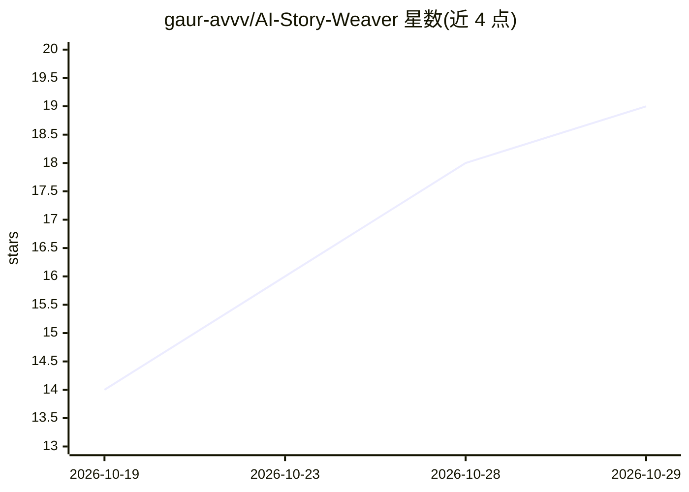

# gaur-avvv/AI-Story-Weaver

⭐ 19 · TypeScript · MIT · 推送 2026-10-28 · [GitHub](https://github.com/gaur-avvv/AI-Story-Weaver) · [官网](https://ai-story-weaver-rosy.vercel.app/) · 个人维护

**生成式多模态互动故事书创作与发布工作台**

基于 React 19/TypeScript/Vite/TailwindCSS 的浏览器端多模态 AI 故事平台：用 LLM 生成分段剧情（每段后 2-4 个分支选择）、多风格场景插画（Imagen 3、DALL-E 3 等多供应商）、TTS 语音朗读，并用 Web Audio API 程序化合成 15 种环境音，无需外部音频资产。内置实体/关系知识图谱防止长篇剧情失忆，支持 EPUB 3.0/PDF/竖屏视频导出，并提供原生 MCP Server 供 Claude Desktop、Cursor、Gemini ADK 的 agent 经 JSON-RPC 2.0 协作。面向读者、教育者、作者、GM 与开发者。

## 筛选速览

| 维度 | 判定 | 备注 |
|---|---|---|
| AI 角色 | `ai-native` | 本体是模型或模型工具 |
| 许可风险 | `permissive` | MIT |
| 部署形态 | `None` |  |
| 模型依赖 | locked-api |  |
| 硬件要求 | — | 无带数字的原话,不猜 |
| 安装摩擦 | `low` | 无编译、无系统依赖或容器化 |
| 成熟度 | — | 结构信号不足 |

## 能力要点

- 分段生成 CYOA 分支剧情，支持重分支回溯与时间线回退
- 多供应商文本/图像/TTS 引擎（Gemini、Groq、OpenAI、Imagen 3、DALL-E 3 等）
- Web Audio 程序化合成 15 种环境音，零外部音频资产
- 原生 MCP Server（JSON-RPC 2.0）接入 Claude Desktop / Cursor / Gemini ADK
- 纯客户端 EPUB 3.0 / PDF / 9:16 视频导出

## 适用场景

- 为孩子创作带插画与朗读的互动睡前故事
- 作家构建多分支剧情并维护设定知识图谱
- 将故事一键导出为电子书或社交媒体短视频

## 场景标签

`语音合成` `知识图谱` `图像生成` · 领域:内容生成

## 证据(README 行号)

> L30: **Novellaio** is an interactive, multi-modal generative AI storytelling platform and creative production studio. Bu
> L70: - The selected AI engine (Google Gemini 2.5 Flash, Puter.js, Groq, OpenAI, etc.) generates the narrative paragraph 

## 星数曲线

2026-10-19 14 → 2026-10-29 19（+5）

---
*卡片 v1 · prompt 1.4 · 生成 2026-10-29 · 置信度 high · 依据 README sha `81d5e55bb0f7` · [字段定义](../../DATASET.md)*
