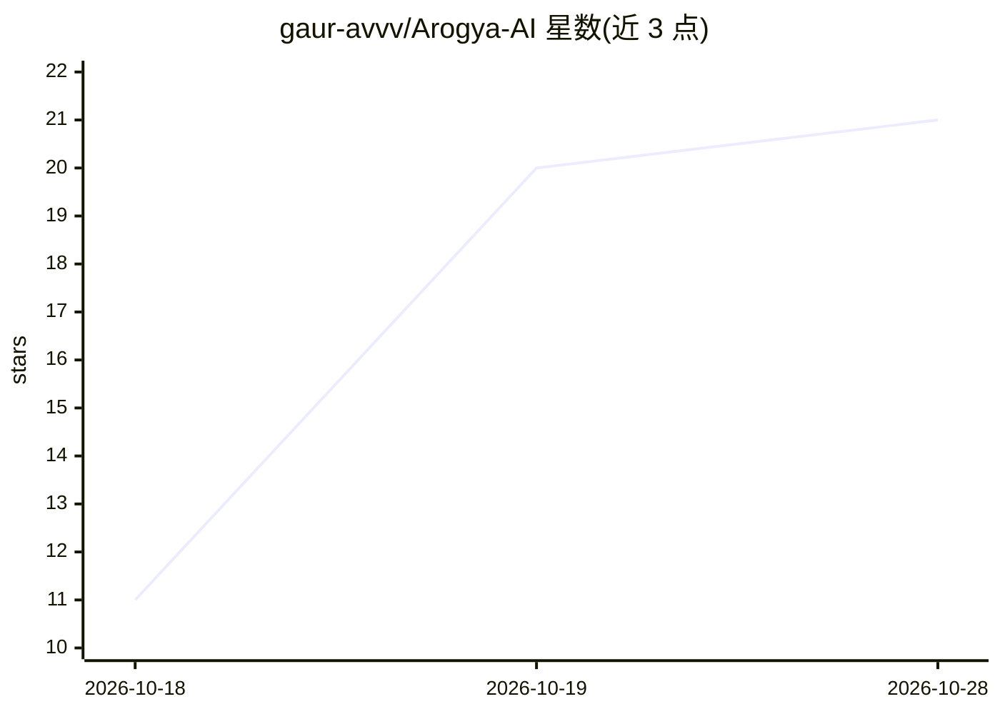

# gaur-avvv/Arogya-AI

⭐ 21 · Python · MIT · 推送 2026-09-25 · [GitHub](https://github.com/gaur-avvv/Arogya-AI) · [官网](https://arogya-ai-mu.vercel.app) · 个人维护

**结合阿育吠陀的疾病预测与健康建议系统（ML+LLM）**

临床决策支持原型系统：Random Forest 模型基于 819 特征（12 项基础健康特征 + 807 个 TF-IDF 症状词）对 399 类疾病做预测，SMOTE 将训练样本从 4,201 扩至 20,748；再用 Gemini 2.5 Pro 结合季节、天气与 Dosha 体质做 LLM 上下文分析，生成含梵文/英文草药名、疗法与饮食建议的阿育吠陀方案。提供 React+FastAPI 全栈 Web 模式（患者/医生 RBAC 双门户）与离线 CLI 模式，LLM 不可用时可离线回退；对患者隐藏低置信度原始诊断标签。README 声明为辅助而非替代执业医师的原型。

## 筛选速览

| 维度 | 判定 | 备注 |
|---|---|---|
| AI 角色 | `ai-native` | 本体是模型或模型工具 |
| 许可风险 | `permissive` | MIT |
| 部署形态 | `library` | 以包/库形式分发 |
| 模型依赖 | — | README 未给出锁定关系 |
| 硬件要求 | — | 无带数字的原话,不猜 |
| 安装摩擦 | `low` | 无编译、无系统依赖或容器化 |
| 成熟度 | — | 结构信号不足 |

## 能力要点

- Random Forest（819 特征、SMOTE 平衡）预测 399 类疾病
- Gemini 2.5 Pro 结合 Dosha 体质与季节做上下文分析
- 患者/医生双门户 RBAC，对患者屏蔽低置信度诊断标签
- LLM 不可用时的离线回退模式

## 适用场景

- 输入症状获得疾病预测与阿育吠陀治疗方案
- 医生查看带可解释性的辅助诊断结果
- 离线场景下用 CLI 进行症状评估

## 场景标签

 · 领域:医疗健康/AI 辅助诊断

## 证据(README 行号)

> L10: ArogyaAI is a comprehensive Clinical Decision Support System (CDSS) that bridges the gap between traditional Ayurve
> L20: 1. Combining mathematical Random Forest predictions (99%+ accuracy) with Generative LLM contextual reasoning.
> L38: * **LLM Contextual Validation:** Evaluates symptoms against season, weather, and dosha using Gemini 2.5 Pro.

## 星数曲线

2026-10-18 11 → 2026-10-28 21（+10）

---
*卡片 v1 · prompt 1.4 · 生成 2026-10-28 · 置信度 high · 依据 README sha `da70731502bf` · [字段定义](../../DATASET.md)*
