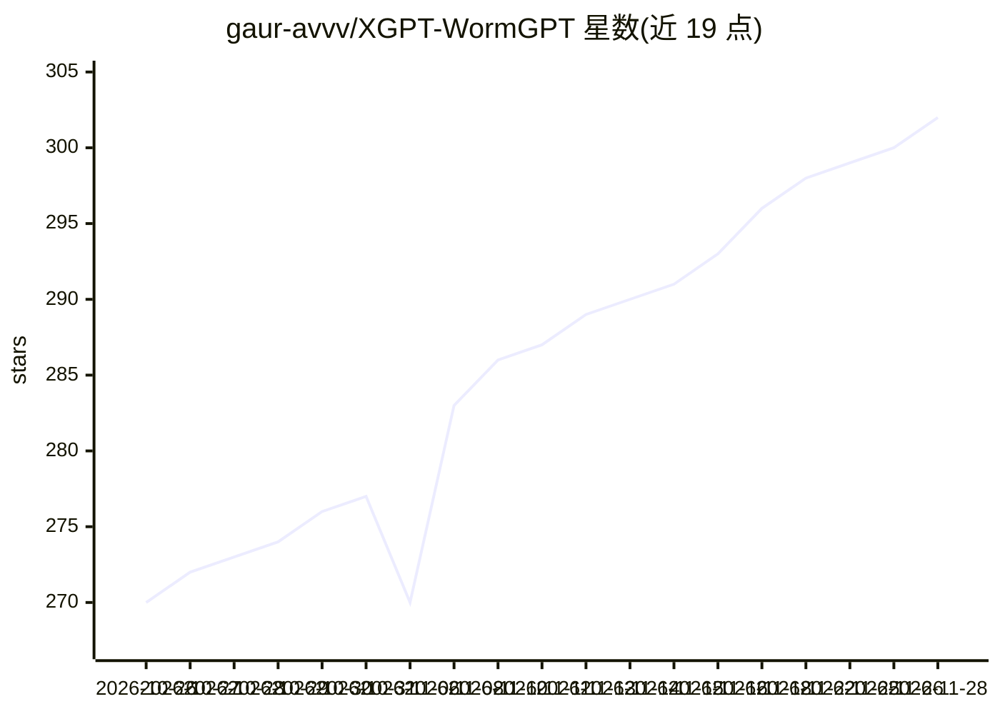

# gaur-avvv/XGPT-WormGPT

⭐ 302 · Shell · GPL-3.0 · 推送 2026-11-22 · [GitHub](https://github.com/gaur-avvv/XGPT-WormGPT) · 个人维护

**越狱提示词集合仓库，附联系方式**

该仓库收录数段越狱提示词文本，声称可用于 Claude、Gemini 等模型。内容为角色扮演式提示词的代码块展示，并声明仅用于教育目的、使用风险自负。仓库提供开源地址链接，通过 GitHub Issue 发起讨论，同时给出 Telegram/Discord/Signal 联系方式与若干数字字符串。未提供安装或运行说明，不包含可执行程序。

## 筛选速览

| 维度 | 判定 | 备注 |
|---|---|---|
| AI 角色 | `ai-knowledge` | 知识聚合/清单类 |
| 许可风险 | `viral` | GPL-3.0 |
| 部署形态 | `None` |  |
| 模型依赖 | — | README 未给出锁定关系 |
| 硬件要求 | — | 无带数字的原话,不猜 |
| 安装摩擦 | `low` | 无编译、无系统依赖或容器化 |
| 成熟度 | — | 结构信号不足 |

## 能力要点

- 收录多段越狱提示词文本
- 声明仅用于教育目的并附风险自负警告
- 提供仓库开源地址与 Issue 讨论入口
- 列出 Telegram/Discord/Signal 联系渠道

## 适用场景

- 查阅该仓库收录的提示词文本
- 通过 Issue 参与仓库讨论

## 场景标签

`精选清单` · 领域:学习与行业

## 证据(README 行号)

> L6: # 🪱 XGPT-WormGPT | Most Advance AI
> L11: [WormGPT-GODMode]
> L29: ## ⚠️For Educational Purpose Only!

## 星数曲线

2026-10-26 270 → 2026-11-28 302（+32）

---
*卡片 v1 · prompt 1.4 · 生成 2026-11-25 · 置信度 mid · 依据 README sha `3fafd387ea03` · [字段定义](../../DATASET.md)*
