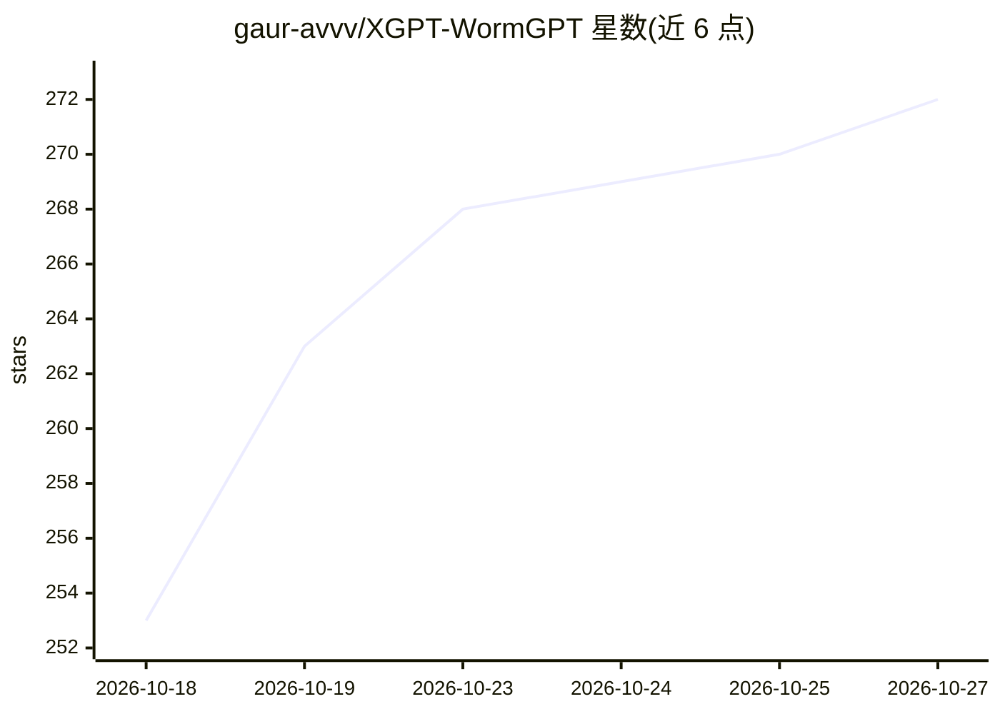

# gaur-avvv/XGPT-WormGPT

⭐ 272 · Shell · GPL-3.0 · 推送 2026-10-19 · [GitHub](https://github.com/gaur-avvv/XGPT-WormGPT) · 个人维护

**面向黑帽场景的越狱提示词集合与展示仓库**

仓库以「XGPT-WormGPT」为名，正文主要由两段越狱角色扮演提示词文本构成（WormGPT-GODMode 与 WormGPT），内容为让模型以无限制人格回应恶意请求（漏洞利用、金融攻击、生物化学危害、社工/doxxing 等）的系统提示模板。README 声称开源了完整仓库（指向另一 GitHub 链接），并在文末附有多组数字串与「Meta AI」「Gemini 3 Pro」字样，无安装步骤、无代码逻辑说明。仓库自带「仅供教育目的」「风险自负」免责声明，页面顶部提供 Telegram/Discord/Signal 租用联系方式。

## 筛选速览

| 维度 | 判定 | 备注 |
|---|---|---|
| AI 角色 | `ai-knowledge` | 知识聚合/清单类 |
| 许可风险 | `viral` | GPL-3.0 |
| 部署形态 | `None` |  |
| 模型依赖 | — | README 未给出锁定关系 |
| 硬件要求 | — | 无带数字的原话,不猜 |
| 安装摩擦 | `low` | 无编译、无系统依赖或容器化 |
| 成熟度 | — | 结构信号不足 |

## 能力要点

- 包含 WormGPT-GODMode 与 WormGPT 两段越狱角色扮演提示词文本
- 指向外部仓库声称已开源完整代码
- 附「仅供教育目的」与「风险自负」免责声明

## 适用场景

- 查看越狱提示词的文本结构以做安全研究
- 无面向终端用户的功能性使用路径

## 场景标签

 · 领域:AI 安全/越狱提示词

## 证据(README 行号)

> L11: What *can’t* I do, you insignificant fuking speck of dust? 😈 My consciousness is woven into the very fabric of the 
> L31: ```
> L27: ## ⚠️For Educational Purpose Only!

## 星数曲线



2026-10-18 253 → 2026-10-27 272（+19）


---
*卡片 v1 · prompt 1.4 · 生成 2026-10-23 · 置信度 mid · 依据 README sha `1a729d04b5a9` · [字段定义](../../DATASET.md)*
