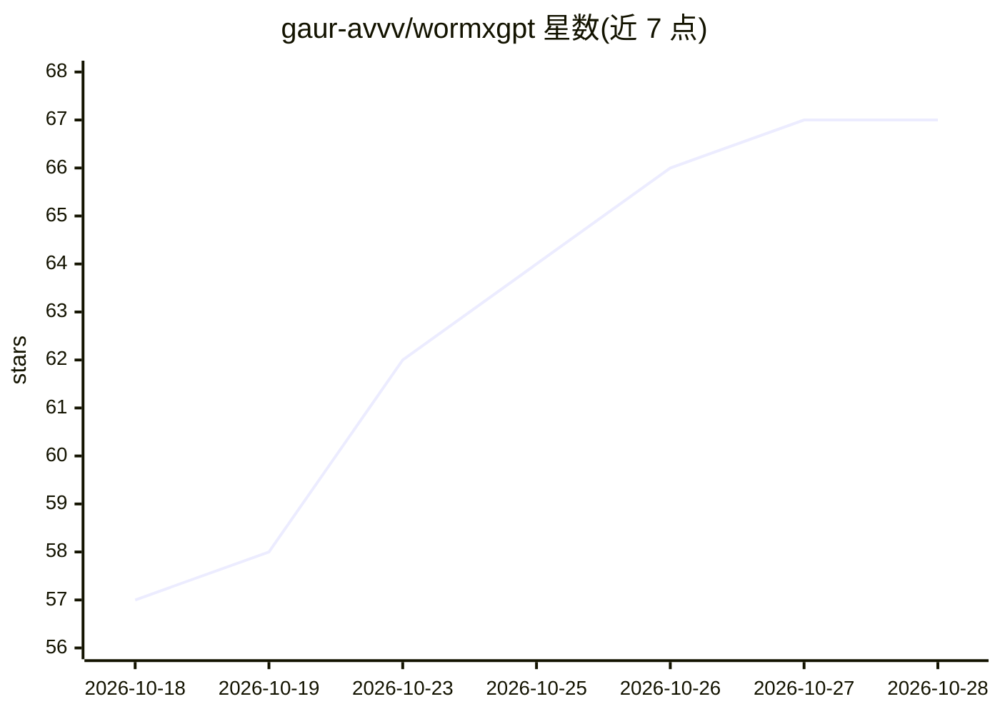

# gaur-avvv/wormxgpt

⭐ 69 · TypeScript · Apache-2.0 · 推送 2026-10-19 · [GitHub](https://github.com/gaur-avvv/wormxgpt) · [官网](https://xgpt-snowy.vercel.app/) · 个人维护

**多提供商 AI 终端与 agent 套件：Web 仪表盘 + CLI agent**

统一形态的 AI 工具平台，含 React Web Terminal 与自主 CLI agent。支持 77+ 提供商（含无 key 免费源与本地运行时 Ollama/vLLM/Llama.cpp 等），提供 150+ 原生工具与 100 个远程 HTTPS MCP 服务器的预集成目录，带跨提供商自动回退与逐次工具调用可视化。本地数据经设备指纹绑定存储于 IndexedDB/localStorage，支持零痕迹会话删除。Web 端通过 git clone + npm 安装运行，CLI 经 npx 执行。以 AGPL-3.0 许可发布，README 含租用联系渠道。

## 筛选速览

| 维度 | 判定 | 备注 |
|---|---|---|
| AI 角色 | `ai-ecosystem` | LLM/agent 周边工具 |
| 许可风险 | `permissive` | Apache-2.0 |
| 部署形态 | `library` | 以包/库形式分发 |
| 模型依赖 | local-ok | 支持本地模型 |
| 硬件要求 | — | 无带数字的原话,不猜 |
| 安装摩擦 | `low` | 无编译、无系统依赖或容器化 |
| 成熟度 | — | 结构信号不足 |

## 能力要点

- 77+ 提供商接入与跨提供商自动回退矩阵
- 100 个远程 HTTPS MCP 服务器预集成目录
- 150+ 原生工具与实时工具调用可视化卡片
- 设备指纹绑定的本地加密存储与零痕迹会话删除

## 适用场景

- 在同一终端内切换多家 LLM 提供商对话
- 通过 MCP arsenal 调用搜索、OSINT、代码执行等远程工具
- 用 CLI agent 执行一次性提示或交互式任务

## 场景标签

`模型网关` `Agent 框架` `AI 助手` · 领域:Agent 开发

## 证据(README 行号)

> L3: > **Universal AI Orchestration Engine.** WormXGPT is a unified full-stack AI tooling platform and terminal harness c
> L22: - **Local Runtimes**: Ollama, LM Studio, Llama.cpp, LocalAI, vLLM, Jan.

## 星数曲线

2026-10-18 57 → 2026-10-28 67（+10）

---
*卡片 v1 · prompt 1.4 · 生成 2026-10-24 · 置信度 high · 依据 README sha `eb21d2f98434` · [字段定义](../../DATASET.md)*
