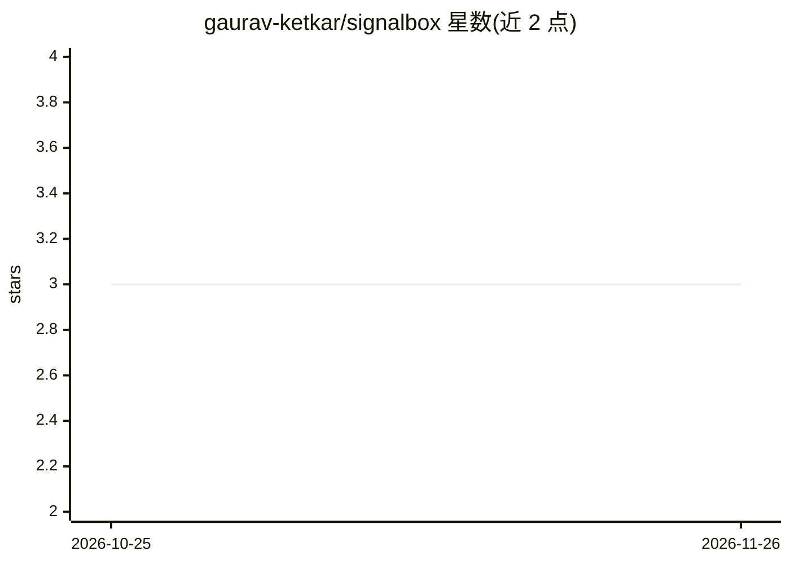

# gaurav-ketkar/signalbox

⭐ 3 · JavaScript · Apache-2.0 · 推送 2026-11-13 · [GitHub](https://github.com/gaurav-ketkar/signalbox) · 个人维护

**为 GitHub 通知做本地 AI 摘要与优先级分诊的 Chrome 扩展**

一个免构建的 Chrome Manifest V3 扩展，在 GitHub 通知页新增 Today、Priority、Subscriptions 三个视图：对所有过滤视图内联生成线程摘要、按规则与 72 小时 SLA 曲线打 0-100 优先级分、一键批量归档噪音通知。摘要可由本地引擎（Splash、Apple MLX、LM Studio、Ollama）或可选云端（GitHub Copilot、OpenAI、Anthropic、Google Gemini）生成，支持本地/云混合路由与 SHA-256 摘要缓存。以未打包扩展形式分发，需 Chrome 120+。

## 筛选速览

| 维度 | 判定 | 备注 |
|---|---|---|
| AI 角色 | `ai-native` | 本体是模型或模型工具 |
| 许可风险 | `permissive` | Apache-2.0 |
| 部署形态 | `desktop` | 安装包/桌面程序 |
| 模型依赖 | local-ok | 支持本地模型 |
| 硬件要求 | — | 无带数字的原话,不猜 |
| 安装摩擦 | `low` | 无编译、无系统依赖或容器化 |
| 成熟度 | — | 结构信号不足 |

## 能力要点

- Today/Priority/Subscriptions 三个通知视图与一键 Quick Sweep 批量归档
- 本地推理引擎支持：Splash、Apple MLX、LM Studio、Ollama
- 可选云端模型：GitHub Copilot、OpenAI、Anthropic、Google Gemini
- 多阶段线程抽取与按模型 token 预算调度的并行摘要

## 适用场景

- 将 GitHub 通知摘要为需回复/不明确请求/FYI 三类清单
- 全本地推理保持零成本并管理海量通知
- 跟踪特定 issue、PR、release 的订阅视图

## 场景标签

 · 领域:开发者工具/浏览器扩展

## 证据(README 行号)

> L13: Signalbox is an unpacked Chrome extension that adds **Today**, **Priority**, and **Subscriptions** views to GitHub 
> L28: - **Context-window parallel AI (Local, Cloud, or Hybrid Two-Slot):** Schedules concurrent summaries up to your mode

## 星数曲线

2026-10-25 3 → 2026-11-26 3（+0）

---
*卡片 v1 · prompt 1.4 · 生成 2026-11-22 · 置信度 high · 依据 README sha `be74027c0ace` · [字段定义](../../DATASET.md)*
