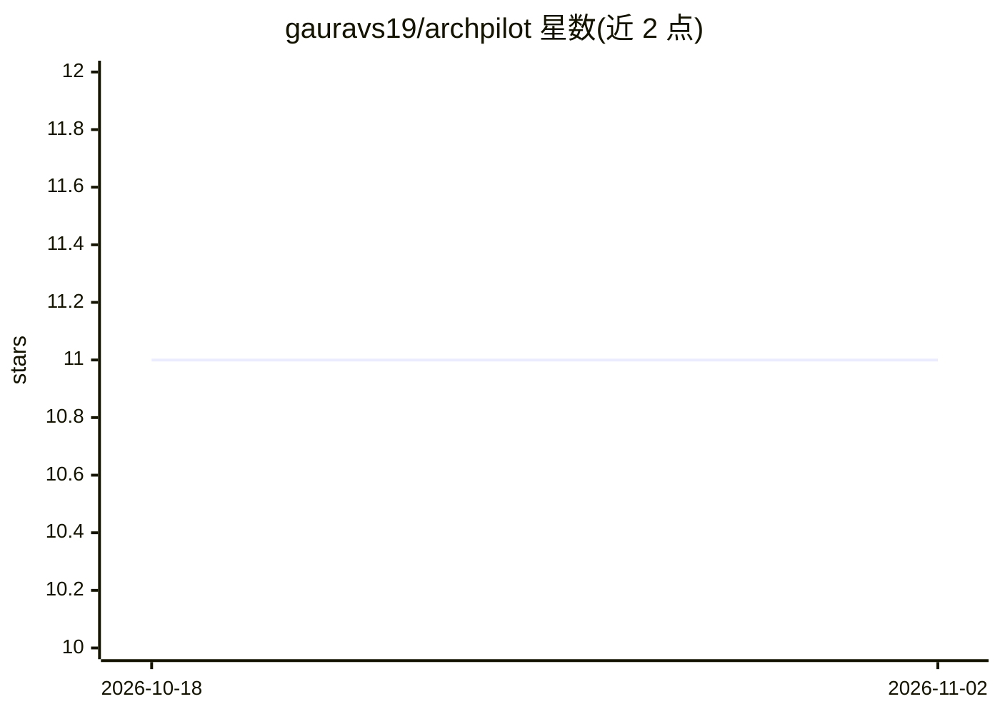

# gauravs19/archpilot

⭐ 11 · Python · MIT · 推送 2026-07-25 · [GitHub](https://github.com/gauravs19/archpilot) · [官网](https://gauravs19.github.io/archpilot/) · 个人维护

**企业架构标准库+智能体流水线：把高层需求转为全套架构文档**

双模式仓库：一是标准库，36+ 个规则文件、17 个模板与 5 套 LLM 配置，可粘贴进 Claude、Cursor、Copilot、ChatGPT 等工具，约束其产出企业级设计；二是 `archpilot run` 智能体流水线，输入单条需求经 5 个 AI 阶段生成发现报告、EARS 需求、HLD、LLD 与评分守卫审查（≥80/100 才放行），并有 GitHub Action 在 PR 中自动审计设计文档。附带 CLI（init/run/review/lint），以 Python 脚本与 Markdown 规则文件形式提供。

## 筛选速览

| 维度 | 判定 | 备注 |
|---|---|---|
| AI 角色 | `ai-native` | 本体是模型或模型工具 |
| 许可风险 | `permissive` | MIT |
| 部署形态 | `None` |  |
| 模型依赖 | locked-api |  |
| 硬件要求 | — | 无带数字的原话,不猜 |
| 安装摩擦 | `low` | 无编译、无系统依赖或容器化 |
| 成熟度 | — | 结构信号不足 |

## 能力要点

- 5 阶段智能体流水线从单条需求产出 6 件架构制品
- 36+ 规则文件/17 模板可加载进 Claude、Cursor、Copilot 等任意 LLM
- 评分守卫（≥80/100）与 EARS 记法需求门禁
- GitHub Action 在 PR 中自动审计架构缺口

## 适用场景

- 绿地项目从一句话需求生成完整 HLD/LLD 文档包
- 给现有 LLM 工具链注入企业架构规范做守卫
- 架构评审委员会（ARB）提交前自查设计质量

## 场景标签

`提示工程` `Agent 框架` · 领域:Agent 开发

## 证据(README 行号)

> L41: |**Agentic Pipeline**|`archpilot run` — takes one requirement, runs 5 AI agent phases, produces 6 production-grade 
> L48: Give Archpilot a single requirement. Five AI agent phases produce a complete, lint-clean architecture package:
> L68: Plug Archpilot rule files into any LLM to enforce consistent, enterprise-grade design:

## 星数曲线

2026-10-18 11 → 2026-11-02 11（+0）

---
*卡片 v1 · prompt 1.4 · 生成 2026-11-02 · 置信度 high · 依据 README sha `c89763a9f498` · [字段定义](../../DATASET.md)*
