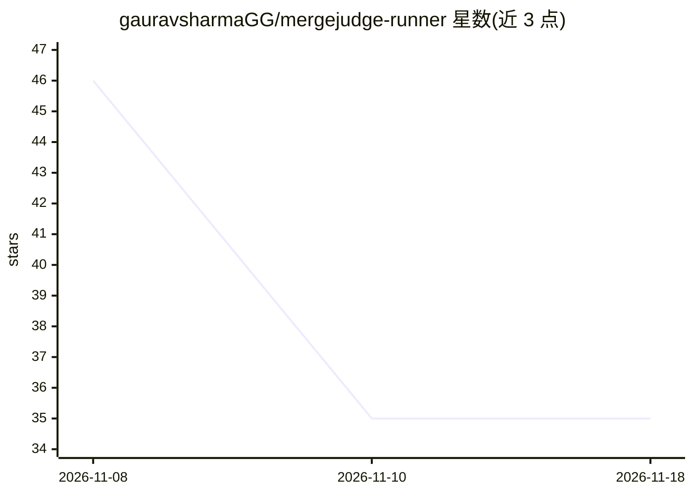

# gauravsharmaGG/mergejudge-runner

⭐ 35 · JavaScript · MIT · 推送 2026-11-17 · [GitHub](https://github.com/gauravsharmaGG/mergejudge-runner) · [官网](https://mergejudge.si) · 个人维护

**给工程团队的自托管 AI 代码审查 GitHub Action 与 CLI**

MIT 许可的自托管 GitHub Action 与 CLI（mergejudge-runner），将 pull request 分入 auto/review/block 三条风险通道并产出摘要评论、行内缺陷与 GitHub 状态检查。机制上分两层：确定性规则（路径、密钥、规模）设定风险下限，可选的 AI 两阶段对抗验证（先提出候选缺陷并引用 diff，再尝试证伪）可提升但不可降低下限；配置从 base 分支读取以防被 PR 自身削弱。支持 BYOM（Anthropic/OpenAI/Gemini/本地 Ollama），也支持 provider:none 的纯规则模式（零模型调用）。另含托管 runner 模式，AI 步骤跑在用户自己的机器上。50-PR 离线基准上精确率 75.9%（--deep）/75.0%（默认）。

## 筛选速览

| 维度 | 判定 | 备注 |
|---|---|---|
| AI 角色 | `ai-native` | 本体是模型或模型工具 |
| 许可风险 | `permissive` | MIT |
| 部署形态 | `library` | 以包/库形式分发 |
| 模型依赖 | local-ok | 支持本地模型 |
| 硬件要求 | — | 无带数字的原话,不猜 |
| 安装摩擦 | `low` | 无编译、无系统依赖或容器化 |
| 成熟度 | — | 结构信号不足 |

## 能力要点

- 确定性规则设定风险下限，AI 只能提升不能降低
- 两阶段对抗验证：候选缺陷须引用 diff 且被证伪检验后才发布
- BYOK 接入 Anthropic/OpenAI/Gemini/OpenAI 兼容或本地 Ollama
- provider:none 纯规则模式零外部模型调用
- 配置从 base 分支读取，防 PR 削弱自身审查门禁

## 适用场景

- GitHub 仓库用风险通道与合并门禁自动化 PR 审查
- 工程团队用自有 AI key 做可审计的代码审查
- 仅用确定性规则做零模型调用的 PR 门禁

## 场景标签

`代码审查` · 领域:编码与开发

## 证据(README 行号)

> L3: Risk-aware AI pull request reviews, with deterministic rules and merge gates you control.
> L5: MergeJudge (`mergejudge-runner`) is a self-hostable, MIT-licensed GitHub Action and CLI that evaluates pull requests
> L9: - **Two-pass adversarial verification:** Pass 1 proposes candidate defects with exact diff line quotes; Pass 2 indep

## 星数曲线

2026-11-08 46 → 2026-11-18 35（-11）

---
*卡片 v1 · prompt 1.4 · 生成 2026-11-18 · 置信度 mid · 依据 README sha `8d862d29b929` · [字段定义](../../DATASET.md)*
