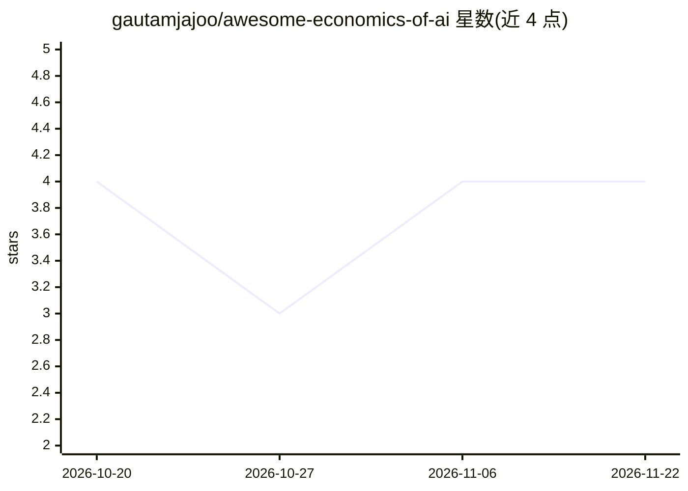

# gautamjajoo/awesome-economics-of-ai

⭐ 4 · 推送 2026-10-13 · [GitHub](https://github.com/gautamjajoo/awesome-economics-of-ai) · [官网](https://jajoo.xyz/economics-of-ai/) · 个人维护

**AI 成本与经济影响研究的资源导航清单**

按经济学问题分类组织的研究/数据集/分析汇编，覆盖算力与基础设施、云市场、数据中心投资、融资风险、能源约束、训练与推理成本等板块。每条目附简述与来源标签（Study/Data/Report 等），标注数据局限与获取门槛（如付费订阅）。目标读者为研究者、开发者、投资者与政策读者，通过贡献指南接受社区补充。

## 筛选速览

| 维度 | 判定 | 备注 |
|---|---|---|
| AI 角色 | `ai-knowledge` | 知识聚合/清单类 |
| 许可风险 | `none` | — |
| 部署形态 | `None` |  |
| 模型依赖 | — | README 未给出锁定关系 |
| 硬件要求 | — | 无带数字的原话,不猜 |
| 安装摩擦 | `medium` | 含编译或系统依赖之一 |
| 成熟度 | — | 结构信号不足 |

## 能力要点

- 按经济问题分组的分类结构（算力/云/数据中心/能源/训练/推理成本）
- 统一的来源标签体系区分实证研究、理论、数据集、报告等类型
- 条目附方法局限与适用边界说明

## 适用场景

- 查找 AI 训练/推理成本的实证研究与数据集
- 调研数据中心能耗与电力约束的政策报告
- 了解 AI 投资与融资风险的行业分析

## 场景标签

`精选清单` · 领域:学习与行业

## 证据(README 行号)

> L1: # Awesome Economics of AI
> L6: A curated guide to the costs, markets, adoption, and economic effects of AI.
> L10: This list brings together research, datasets, and analysis scattered across academic, policy, and industry sources.

## 星数曲线

2026-10-20 4 → 2026-11-22 4（+0）

---
*卡片 v1 · prompt 1.4 · 生成 2026-11-21 · 置信度 high · 依据 README sha `e6af3c6dfa71` · [字段定义](../../DATASET.md)*
