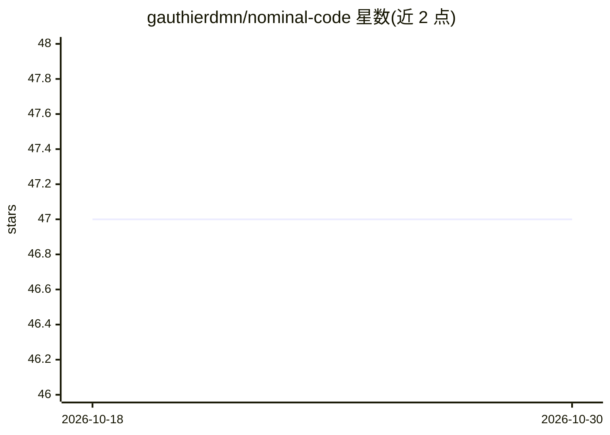

# gauthierdmn/nominal-code

⭐ 47 · Python · Apache-2.0 · 推送 2026-06-19 · [GitHub](https://github.com/gauthierdmn/nominal-code) · 个人维护

**自动化 PR 代码审查机器人，AI 评审结果内联到代码行**

面向 GitHub/GitLab 的代码审查机器人：读取 PR diff，运行可访问仓库的 AI 评审 agent（API 模式下可派生 explore 子 agent 追溯调用方、检查测试与类型），生成锚定具体代码行的结构化内联评论与一键应用修复。支持 7 种 LLM 提供商 API 或 Claude Code CLI，可作为 CI 任务、CLI 命令或自托管 webhook 服务器运行，支持 Kubernetes 上以隔离 Job 部署。可通过自定义 prompt 与 .nominal/guidelines.md 调整评审规则，配置采用 YAML 文件加环境变量覆盖。

## 筛选速览

| 维度 | 判定 | 备注 |
|---|---|---|
| AI 角色 | `ai-native` | 本体是模型或模型工具 |
| 许可风险 | `permissive` | Apache-2.0 |
| 部署形态 | `None` |  |
| 模型依赖 | locked-api |  |
| 硬件要求 | — | 无带数字的原话,不猜 |
| 安装摩擦 | `low` | 无编译、无系统依赖或容器化 |
| 成熟度 | — | 结构信号不足 |

## 能力要点

- 多轮评审 agent 可派生 explore 子 agent 深入调查代码库
- 评论锚定具体代码行并提供一键应用修复
- 7 种 LLM 提供商 API 或 Claude Code CLI（订阅制免 API key）
- GitHub 与 GitLab 双平台，CI/CLI/webhook/Kubernetes 四种运行方式

## 适用场景

- 在 PR 上自动获得内联 AI 代码审查
- 团队自托管 webhook 评审机器人并多轮追问
- 按仓库 guidelines.md 定制评审重点（如安全性）

## 场景标签

`代码审查` · 领域:编码与开发

## 证据(README 行号)

> L10: Nominal Code reads your PR diffs, runs an AI agent with access to the repository, and posts structured inline revie
> L12: In **API mode** (CI, or webhook/CLI with a provider key), a multi-turn reviewer agent investigates the codebase dir

## 星数曲线

2026-10-18 47 → 2026-10-30 47（+0）

---
*卡片 v1 · prompt 1.4 · 生成 2026-10-25 · 置信度 high · 依据 README sha `c809dd9b382f` · [字段定义](../../DATASET.md)*
