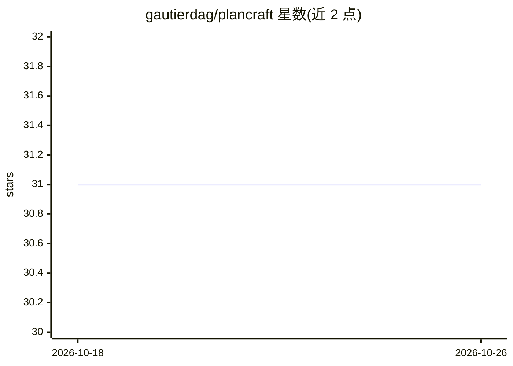

# gautierdag/plancraft

⭐ 31 · Python · MIT · 推送 2025-11-07 · [GitHub](https://github.com/gautierdag/plancraft) · [官网](https://gautierdag.github.io/plancraft/) · 个人维护

**Minecraft 合成任务环境与 LLM agent 规划能力评测套件**

提供基于 Minecraft 简化合成任务的多模态环境与数据集，用于评测 LLM agent 的规划能力：agent 需从初始物品通过移动/熔炼库存物品合成目标物。提供 Gym API 风格的 PlancraftGymWrapper、低层 PlancraftEnvironment 与系统化评测的 Evaluator 类；环境确定且有状态。含 oracle RAG 检索器，被 COLM 2025 接收。注意：原论文基线结果因环境 bug 被低估，作者要求使用者自行复跑基线作为比较基准。

## 筛选速览

| 维度 | 判定 | 备注 |
|---|---|---|
| AI 角色 | `ai-ecosystem` | LLM/agent 周边工具 |
| 许可风险 | `permissive` | MIT |
| 部署形态 | `self-host` | docker 或自建部署 |
| 模型依赖 | — | README 未给出锁定关系 |
| 硬件要求 | — | 无带数字的原话,不猜 |
| 安装摩擦 | `low` | 无编译、无系统依赖或容器化 |
| 成熟度 | `idea` | |

## 能力要点

- Gym API 风格的 PlancraftGymWrapper 便于接入自定义 agent
- 确定性、有状态的库存合成环境，观察含文本/库存/图像
- Evaluator 类支持系统化评测、提前停止与结果保存
- 提供 Docker 镜像与复现论文结果的脚本

## 适用场景

- 评测自研 LLM agent 在规划任务上的表现
- 复现论文结果表并作为比较基线
- 以 Gym 接口快速原型化规划 agent

## 场景标签

`模型评测` · 领域:评测与运维

## 证据(README 行号)

> L23: Plancraft is a minecraft environment that benchmarks planning in LLM agents with an oracle RAG retriever.
> L42: The package provides a multimodal environment and dataset for evaluating planning agents. The dataset consists of e
> L73: For more advanced use cases, the package provides an `Evaluator` class for systematic evaluation of models on our d

## 星数曲线

2026-10-18 31 → 2026-10-26 31（+0）

---
*卡片 v1 · prompt 1.4 · 生成 2026-10-26 · 置信度 high · 依据 README sha `211e84822002` · [字段定义](../../DATASET.md)*
