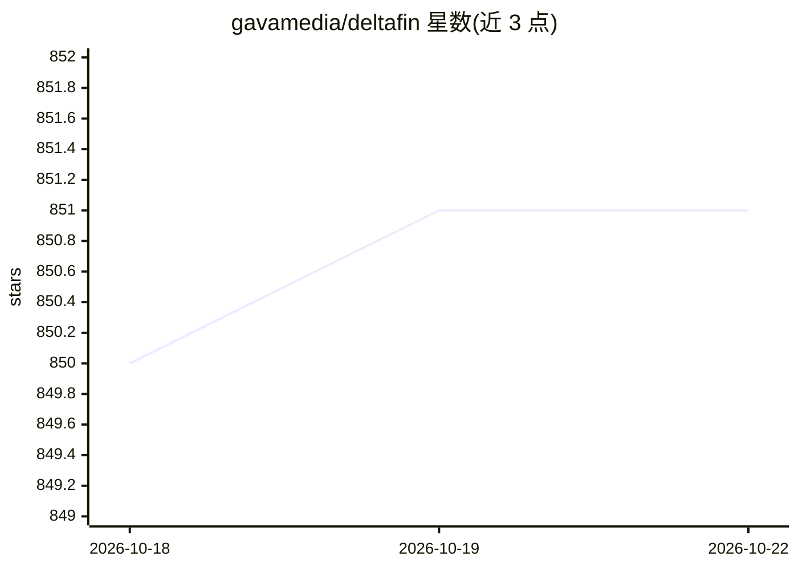

# gavamedia/deltafin

⭐ 851 · Rust · NOASSERTION · 推送 2026-10-04 · [GitHub](https://github.com/gavamedia/deltafin) · 个人维护

**单机运行完整 2.8T 参数 Kimi K3 的原生二进制与 OpenAI 兼容服务器**

单个原生二进制（Rust 核心、C-ABI provider），在消费级硬件上运行未剪枝、16 专家全量路由的 Kimi K3（2.8 万亿参数），所有 token 由 K3 自身裁决，小模型（DSpark/可选 Qwen）仅作猜测式加速并经 K3 校验。安装经 git clone 后运行 setup 下载模型，支持流式按需拉取专家以节省磁盘（起始 215 GB）。内建 OpenAI 兼容服务器（/v1/chat/completions、/v1/completions、/v1/models），实现严格限定的子集：纯文本、单次生成、贪婪可复现，默认响应上限一百万 token。支持 MPS/Metal、CUDA、原生 CPU 平台。M1 Max 基准吞吐约 0.29 token/s。项目自述为消费硬件极限的实验。

## 筛选速览

| 维度 | 判定 | 备注 |
|---|---|---|
| AI 角色 | `ai-ecosystem` | LLM/agent 周边工具 |
| 许可风险 | `none` | NOASSERTION |
| 部署形态 | `None` |  |
| 模型依赖 | — | README 未给出锁定关系 |
| 硬件要求 | — | 无带数字的原话,不猜 |
| 安装摩擦 | `medium` | 含编译或系统依赖之一 |
| 成熟度 | `idea` | |

## 能力要点

- 单二进制运行全量未剪枝 Kimi K3，全部 16 专家逐 token 路由
- OpenAI 兼容服务器，实现纯文本、贪婪可复现的严格 API 子集
- setup --stream 流式按需拉取专家，起始仅需 215 GB 磁盘
- DSpark/可选 Qwen 小模型猜测加速，输出经 K3 校验保持一致

## 适用场景

- 在单台消费级设备上本地运行完整 Kimi K3 做对话与补全
- 把本地 K3 通过 OpenAI 兼容 API 接给聊天/编码 agent
- 研究超大规模 MoE 模型在消费硬件上的极限运行

## 场景标签

`推理引擎` · 领域:训练与推理

## 证据(README 行号)

> L127: ## 4. Use through an OpenAI-compatible server
> L139: The native server implements `/v1/chat/completions`, `/v1/completions` and `/v1/models`, including server-sent-eve
> L141: The server implements a deliberately small, strictly-checked subset of the OpenAI API — text-only, one generation 

## 星数曲线

2026-10-18 850 → 2026-10-22 851（+1）

---
*卡片 v1 · prompt 1.4 · 生成 2026-10-21 · 置信度 high · 依据 README sha `c25c1bb3a340` · [字段定义](../../DATASET.md)*
