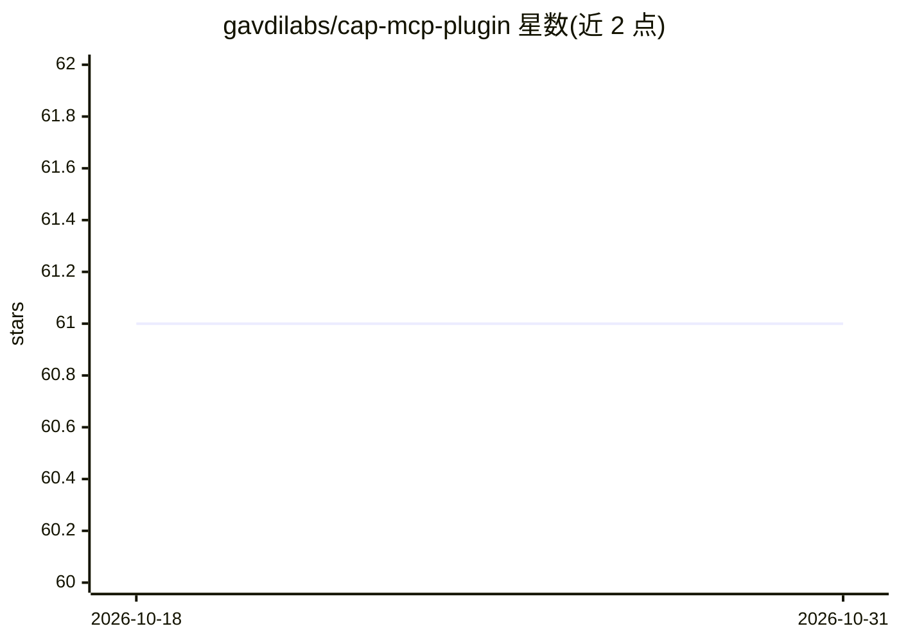

# gavdilabs/cap-mcp-plugin

⭐ 61 · TypeScript · NOASSERTION · 推送 2026-07-17 · [GitHub](https://github.com/gavdilabs/cap-mcp-plugin) · 组织维护

**从 CAP 服务自动生成 MCP server 的 NodeJS 插件**

面向 SAP CAP（Cloud Application Programming）应用的插件，通过 `@mcp` 系列注解把 CAP OData 服务转换为 Model Context Protocol 服务器：实体暴露为支持 OData v4 查询的 MCP resources，函数/动作转为可执行 MCP tools，另提供 prompt 模板、elicitation 用户确认、`@mcp.omit` 敏感字段过滤与 `@mcp.hint` 字段级描述。遵循 CAP 标准插件架构，npm 安装后自动集成，MCP 端点默认位于 `http://localhost:4004/mcp`。要求 Node.js 18+、SAP CAP 10+、Express 5+。

## 筛选速览

| 维度 | 判定 | 备注 |
|---|---|---|
| AI 角色 | `ai-ecosystem` | LLM/agent 周边工具 |
| 许可风险 | `none` | NOASSERTION |
| 部署形态 | `library` | 以包/库形式分发 |
| 模型依赖 | — | README 未给出锁定关系 |
| 硬件要求 | — | 无带数字的原话,不猜 |
| 安装摩擦 | `low` | 无编译、无系统依赖或容器化 |
| 成熟度 | — | 结构信号不足 |

## 能力要点

- `@mcp` 注解自动生成 MCP resources/tools/prompts 端点
- 实体包装工具（query/get/create/update）供 LLM 调用
- `@mcp.omit` 从 MCP 响应中过滤敏感字段
- `elicit` 机制在工具执行前请求用户确认或输入参数

## 适用场景

- 让 Claude 等 MCP 兼容 AI 客户端以自然语言查询我的 SAP CAP 业务数据
- 把 CAP 函数/动作作为 AI agent 可调用的工具暴露
- 通过注解控制 AI 可见字段以满足隐私与合规要求

## 场景标签

 · 领域:企业应用开发/AI 集成

## 证据(README 行号)

> L10: A CAP (Cloud Application Programming) plugin that automatically generates Model Context Protocol (MCP) servers from
> L88: This plugin transforms your annotated CAP services into a fully functional MCP server that can be consumed by any M

## 星数曲线

2026-10-18 61 → 2026-10-31 61（+0）

---
*卡片 v1 · prompt 1.4 · 生成 2026-10-24 · 置信度 high · 依据 README sha `f81c021f3fa8` · [字段定义](../../DATASET.md)*
