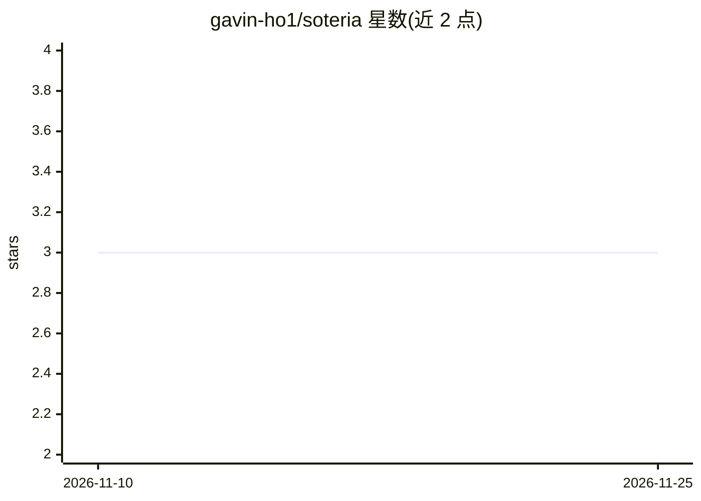

# gavin-ho1/soteria

⭐ 3 · Python · MIT · 推送 2026-10-28 · [GitHub](https://github.com/gavin-ho1/soteria) · 个人维护

**面向癫痫研究者的视频式阵挛发作提前预测模型官方实现**

ICIIBMS 2026 论文 SOTERIA 的官方代码库：基于视频特征，在发作进行中、阵挛发作起始尚不可见时，仅用已观测视频估计是否会到达阵挛起始。机制上以冻结时空外观嵌入 + 因果 LRU 主干 + 前向 HMM 告警解码器组成，全程受因果契约约束（窗口仅含决策时可用特征）。仓库提供训练、滚动回放、统计复现全流程命令，覆盖 10 折×15 种子的患者不相交交叉验证，并附单元测试与已提交的滚动回放结果目录供免重训核验。

## 筛选速览

| 维度 | 判定 | 备注 |
|---|---|---|
| AI 角色 | `ai-native` | 本体是模型或模型工具 |
| 许可风险 | `permissive` | MIT |
| 部署形态 | `library` | 以包/库形式分发 |
| 模型依赖 | — | README 未给出锁定关系 |
| 硬件要求 | — | 无带数字的原话,不猜 |
| 安装摩擦 | `medium` | 含编译或系统依赖之一 |
| 成熟度 | — | 结构信号不足 |

## 能力要点

- 严格因果的预测系统：每个时刻的预测仅依赖截至该时刻的观测
- LRU + 前向 HMM 解码器将逐 token 风险流转为单一告警决策
- 提供论文全部表格（表 I–VI）的复现命令与免重训统计核验路径
- 单元测试覆盖 DeLong 检验与滚动评估契约

## 适用场景

- 复现论文中视频式阵挛发作提前预测的实验结果
- 在患者不相交设定下评估多种时序主干（Transformer/TCN/LSTM/GRU）
- 基于 GESTURES 特征数据集开展癫痫预测研究

## 场景标签

`科研工具` · 领域:学习与行业

## 证据(README 行号)

> L8: This is the official implementation of SOTERIA, accepted at ICIIBMS 2026.
> L12: Most video-based seizure work targets detection: retrospectively judging whether a recorded segment contains a seiz
> L20: SOTERIA combines frozen spatiotemporal appearance embeddings with a causal Linear Recurrent Unit (LRU) backbone and

## 星数曲线

2026-11-10 3 → 2026-11-25 3（+0）

---
*卡片 v1 · prompt 1.4 · 生成 2026-11-22 · 置信度 high · 依据 README sha `da930d9d1756` · [字段定义](../../DATASET.md)*
