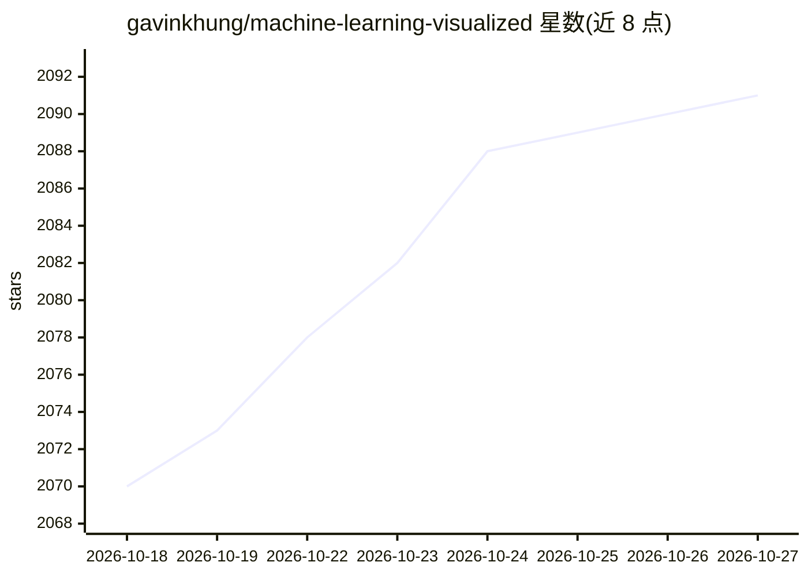

# gavinkhung/machine-learning-visualized

⭐ 2,091 · TeX · MIT · 推送 2026-08-19 · [GitHub](https://github.com/gavinkhung/machine-learning-visualized) · [官网](https://ml-visualized.com/) · 个人维护

**用 NumPy 从第一性原理推导并可视化 ML 算法的 Jupyter Book**

一个 Jupyter Book 构建工程：通过 SH 脚本从各算法独立仓库下载 Jupyter Notebook，再用 jupyter-book CLI 或 Docker 构建成网站，内容包括神经网络、自编码器、逻辑回归、感知机、PCA、K-Means、梯度下降等算法的数学推导与训练过程可视化，另有 Marimo 交互式 Notebook 展示权重对损失函数的影响，并支持生成 EPUB。本仓库不含 Notebook 本体，仅包含构建配置，网站经 GitHub Action 自动更新。

## 筛选速览

| 维度 | 判定 | 备注 |
|---|---|---|
| AI 角色 | `ai-knowledge` | 知识聚合/清单类 |
| 许可风险 | `permissive` | MIT |
| 部署形态 | `self-host` | docker 或自建部署 |
| 模型依赖 | — | README 未给出锁定关系 |
| 硬件要求 | — | 无带数字的原话,不猜 |
| 安装摩擦 | `low` | 无编译、无系统依赖或容器化 |
| 成熟度 | — | 结构信号不足 |

## 能力要点

- 覆盖 7 类机器学习算法的数学推导与训练可视化 Notebook
- Marimo 交互式 Notebook 观察权重对损失函数的影响
- 支持 jupyter-book CLI / Docker Compose / Docker 三种构建方式，可产出 EPUB

## 适用场景

- 通过可视化与推导笔记学习机器学习算法原理
- 本地构建并浏览交互式算法演示网站
- 下载合并 Notebook 生成离线 EPUB 电子书

## 场景标签

`教程课程` · 领域:学习与行业

## 证据(README 行号)

> L7: Machine Learning Visualized is a Jupyter Book containing Jupyter Notebooks that implement and mathematically derive 
> L11: The output of each notebook is a visualization of the machine learning algorithm throughout its training phase, ult

## 星数曲线

2026-10-18 2,070 → 2026-10-27 2,091（+21）

---
*卡片 v1 · prompt 1.4 · 生成 2026-10-21 · 置信度 mid · 依据 README sha `30125a83f869` · [字段定义](../../DATASET.md)*
