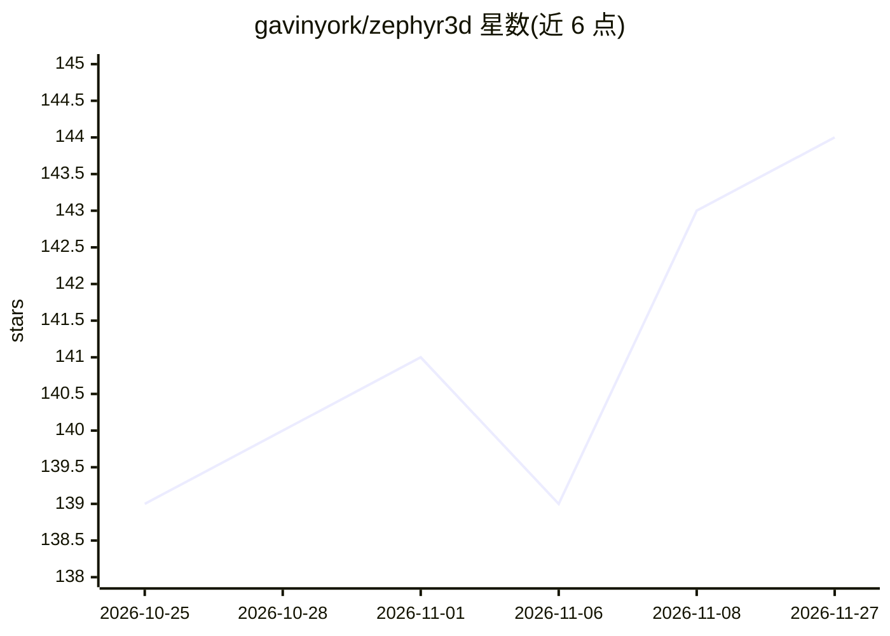

# gavinyork/zephyr3d

⭐ 144 · TypeScript · MIT · 推送 2026-11-26 · [GitHub](https://github.com/gavinyork/zephyr3d) · [官网](https://zephyr3d.org) · 个人维护 · 中文 README

**面向浏览器开发者的 TypeScript 3D 渲染引擎，含可视化编辑器**

以 TypeScript 编写的浏览器 3D 渲染引擎，一套代码库支持 WebGPU 与 WebGL2 双后端，从单一着色器源生成 WGSL 与 GLSL。提供皮肤、头发、水体、地形等渲染技术，模块化 npm 包按需安装，配套可视化编辑器（场景编辑、节点图材质、地形雕刻、动画编辑）。桌面版基于 Electron，内嵌 MCP 服务器供 AI agent 驱动编辑器，并带内置 LLM 助手。项目未达 1.0，API 仍有变动。

## 筛选速览

| 维度 | 判定 | 备注 |
|---|---|---|
| AI 角色 | `ai-enhanced` | 去掉 AI 部分产品仍成立 |
| 许可风险 | `permissive` | MIT |
| 部署形态 | `library` | 以包/库形式分发 |
| 模型依赖 | — | README 未给出锁定关系 |
| 硬件要求 | — | 无带数字的原话,不猜 |
| 安装摩擦 | `low` | 无编译、无系统依赖或容器化 |
| 成熟度 | `idea` | |

## 能力要点

- 单一 TypeScript 着色器源同时生成 WGSL 与 WebGL2 GLSL
- WebGPU/WebGL2 双后端，WebGPU 缺失时自动回退
- 可视化编辑器覆盖场景、材质节点图、地形与动画编辑
- 桌面版内嵌 MCP 服务器与 LLM 助手，API key 本地加密存储

## 适用场景

- 开发需要角色、水体、地形渲染的网页 3D 项目
- 构建自定义工具或内部编辑器
- 学习浏览器端渲染引擎的完整实现

## 场景标签

 · 领域:图形/游戏引擎

## 证据(README 行号)

> L3: A WebGPU-first TypeScript engine with skin, hair, water and terrain rendering,
> L150: The **desktop build** (Electron) adds local project folders with persistent storage, an embedded
> L151: MCP server that lets AI agents and external tools drive the editor, and a built-in LLM assistant.

## 星数曲线

2026-10-25 139 → 2026-11-27 144（+5）

---
*卡片 v1 · prompt 1.4 · 生成 2026-11-27 · 置信度 high · 依据 README sha `8fd328494fc3` · [字段定义](../../DATASET.md)*
