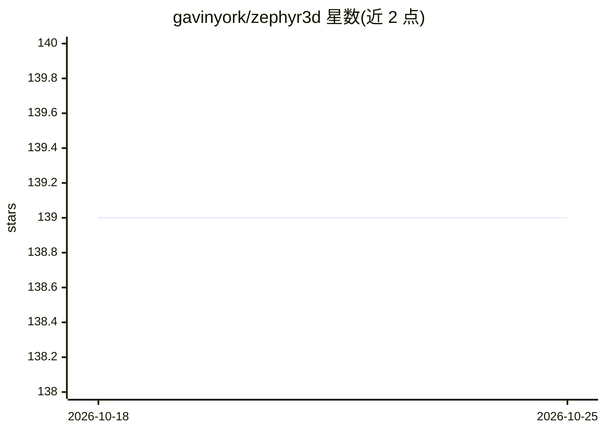

# gavinyork/zephyr3d

⭐ 139 · TypeScript · MIT · 推送 2026-10-23 · [GitHub](https://github.com/gavinyork/zephyr3d) · [官网](https://zephyr3d.org) · 个人维护 · 中文 README

**面向浏览器的 TypeScript 3D 渲染引擎，带可视化编辑器**

TypeScript 编写的浏览器 3D 渲染引擎，单一代码库支持 WebGL/WebGL2/WebGPU 三个后端。分 Device API（图形抽象层，TypeScript 写着色器后自动生成 GLSL/WGSL）与 Scene API（场景图、PBR 材质、集群光照、阴影、地形、水面、动画、后处理）两层，浏览器端与 Electron 桌面版可视化编辑器。桌面版编辑器内嵌 MCP server 供 AI agent 驱动编辑器，并带 LLM 助手。未到 1.0，API 在小版本间仍会变化，由个人维护。适合自建工具或网页渲染研究的开发者。

## 筛选速览

| 维度 | 判定 | 备注 |
|---|---|---|
| AI 角色 | `ai-enhanced` | 去掉 AI 部分产品仍成立 |
| 许可风险 | `permissive` | MIT |
| 部署形态 | `library` | 以包/库形式分发 |
| 模型依赖 | — | README 未给出锁定关系 |
| 硬件要求 | — | 无带数字的原话,不猜 |
| 安装摩擦 | `low` | 无编译、无系统依赖或容器化 |
| 成熟度 | `idea` | |

## 能力要点

- 单一代码库同时面向 WebGL/WebGL2/WebGPU，着色器以 TypeScript 编写后按后端生成 GLSL/WGSL
- 渲染图组织的 Forward+ 管线、PBR 材质、集群光照、多种阴影与后处理
- 浏览器版与 Electron 桌面版可视化编辑器，支持节点图材质蓝图与插件 API
- 桌面版内嵌 MCP server 供 AI agent 驱动编辑器，并带 LLM 助手

## 适用场景

- 在网页中构建带 PBR 渲染、地形与水面效果的 3D 应用
- 自建编辑器或定制化渲染工具
- 通过 MCP 让 AI agent 自动化操作编辑器工作流

## 场景标签

 · 领域:图形/3D 渲染引擎

## 证据(README 行号)

> L166: The **desktop build** (Electron) adds local project folders with persistent storage, an embedded
> L167: MCP server so AI agents can drive the editor directly, and a built-in LLM assistant. API keys are

## 星数曲线

2026-10-18 139 → 2026-10-25 139（+0）

---
*卡片 v1 · prompt 1.4 · 生成 2026-10-22 · 置信度 high · 依据 README sha `97820174d421` · [字段定义](../../DATASET.md)*
