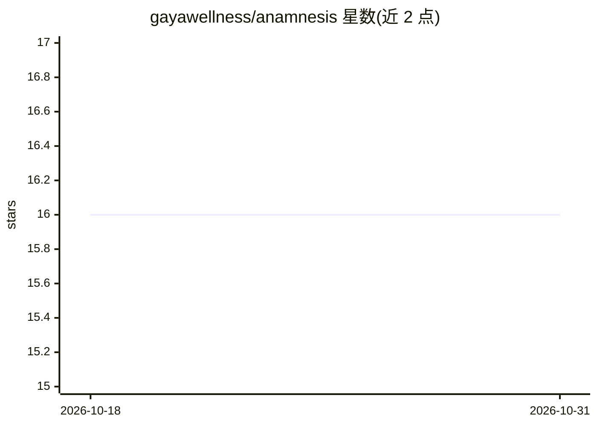

# gayawellness/anamnesis

⭐ 16 · Python · MIT · 推送 2026-04-03 · [GitHub](https://github.com/gayawellness/anamnesis) · 个人维护

**给自主 AI Agent 的持久化战略记忆引擎**

面向 AI agent 的持久记忆服务：以记忆库（bank）为单位存储带战略元数据的记忆（含 reasoning、authority、content_type），通过 retain/recall/reflect/decay_check/reweight 等操作管理。recall 在语义、时间、关系、战略四个维度检索并用 RRF 融合；reflect 可调用 LLM 将记忆综合为指令（无 API key 时返回原始排序记忆）。基于 PostgreSQL+pgvector 存储，默认本地 sentence-transformers 嵌入，可选 Voyage AI；提供 REST API、CLI 与 Claude Code 的 MCP 集成。Docker 部署为主，亦支持 macOS 手动安装。

## 筛选速览

| 维度 | 判定 | 备注 |
|---|---|---|
| AI 角色 | `ai-ecosystem` | LLM/agent 周边工具 |
| 许可风险 | `permissive` | MIT |
| 部署形态 | `self-host` | docker 或自建部署 |
| 模型依赖 | — | README 未给出锁定关系 |
| 硬件要求 | — | 无带数字的原话,不猜 |
| 安装摩擦 | `low` | 无编译、无系统依赖或容器化 |
| 成熟度 | — | 结构信号不足 |

## 能力要点

- 4D 检索（语义+时间+关系+战略）以 RRF 融合排序
- 记忆自动分解为主谓宾三元组并构建实体图
- 默认本地嵌入无需 API key，Docker 一键部署 PostgreSQL+pgvector+服务
- 提供 MCP 集成与 generate-boot-prompt 引导协议生成

## 适用场景

- 让 AI agent 跨会话保留决策背景与优先级
- agent 会话结束时留存成果与交接说明
- 对 agent 记忆做衰减、重加权与过期归档维护

## 场景标签

`Agent 记忆` · 领域:Agent 开发

## 证据(README 行号)

> L3: Anamnesis gives AI agents persistent, strategically-weighted memory across sessions. Instead of flat fact storage, i
> L114: ### MCP Integration (Claude Code)

## 星数曲线

2026-10-18 16 → 2026-10-31 16（+0）

---
*卡片 v1 · prompt 1.4 · 生成 2026-10-30 · 置信度 high · 依据 README sha `b8b6d24fe9fe` · [字段定义](../../DATASET.md)*
