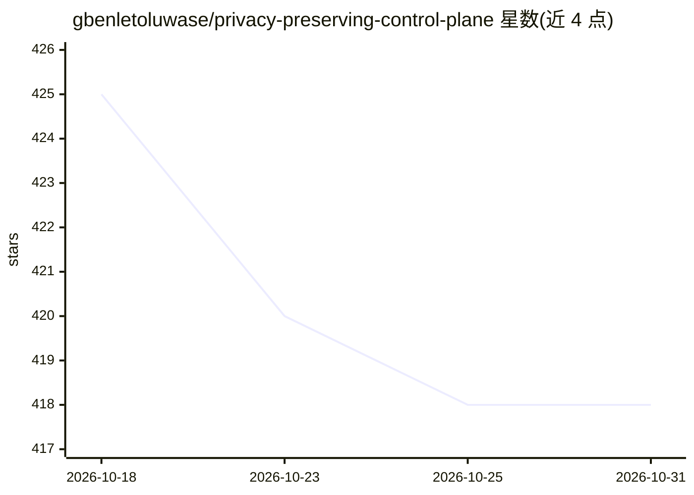

# gbenletoluwase/privacy-preserving-control-plane

⭐ 418 · Java · MIT · 推送 2026-10-17 · [GitHub](https://github.com/gbenletoluwase/privacy-preserving-control-plane) · 个人维护

**Java 隐私保护控制平面：预测扩缩容、PII 脱敏、模型晋升门禁与漂移检测**

面向云原生分布式数据管道运营的 Java 21 库（零运行时依赖，MIT 许可），把四个机制放在一起操作：基于 Holt-Winters 三次指数平滑的预测式扩缩容（含安全因子、阻尼与不对称冷却）、在处理点执行的多语言 PII 脱敏管线（HMAC-SHA256 稳定令牌化、Luhn 校验、重叠区间消解）、带哈希链证据日志的模型晋升门禁，以及基于 PSI 与 MAD 的漂移/异常检测。明确不提供 transformer 识别器、Kubernetes 集成与持久化，这些以接口/文档形式留给使用方扩展。

## 筛选速览

| 维度 | 判定 | 备注 |
|---|---|---|
| AI 角色 | `ai-ecosystem` | LLM/agent 周边工具 |
| 许可风险 | `permissive` | MIT |
| 部署形态 | `None` |  |
| 模型依赖 | — | README 未给出锁定关系 |
| 硬件要求 | — | 无带数字的原话,不猜 |
| 安装摩擦 | `medium` | 含编译或系统依赖之一 |
| 成熟度 | — | 结构信号不足 |

## 能力要点

- 四机制闭环：预测扩缩容、脱敏、模型晋升门禁、漂移/异常检测
- 脱敏采用 HMAC-SHA256 令牌化：同值同令牌，记录可关联但不可逆
- 零运行时依赖，全部基于 JDK 内建；预测器与识别器为可替换接口
- EvidenceLog 哈希链证据日志与 PromotionGate 规则化晋升门禁

## 适用场景

- 在数据处理点对邮箱、电话、信用卡等 PII 做可关联的脱敏
- 为 ML 模型上线设置代码化的资格门禁并留存证据链
- 在负载高峰前按预测预扩容，避免积压窗口
- 监控线上输入分布漂移，作为模型是否仍适用的信号

## 场景标签

`MLOps` · 领域:训练与推理

## 证据(README 行号)

> L17: governed model promotion     ->  a qualification gate inside the deployment path
> L144: `PromotionGate` is a set of rules a model must satisfy before it reaches production

## 星数曲线

2026-10-18 425 → 2026-10-31 418（-7）

---
*卡片 v1 · prompt 1.4 · 生成 2026-10-21 · 置信度 high · 依据 README sha `c9206b020b6a` · [字段定义](../../DATASET.md)*
