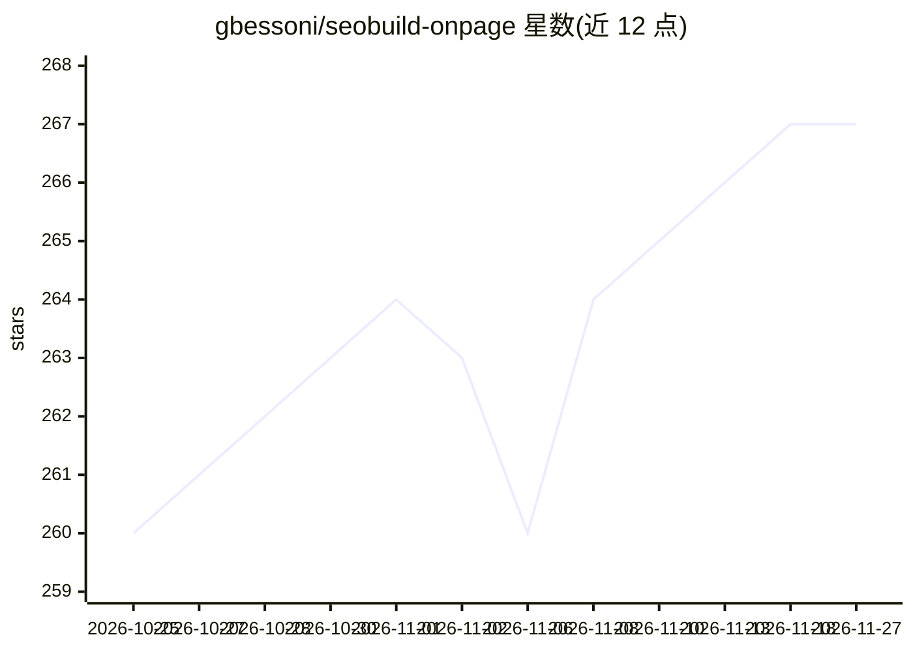

# gbessoni/seobuild-onpage

⭐ 267 · Python · MIT · 推送 2026-11-23 · [GitHub](https://github.com/gbessoni/seobuild-onpage) · 个人维护

**面向 SEO 从业者的 Claude Code 技能：生成针对 Google 排名与 LLM 引用的页面草稿**

一个安装到 Claude Code、Codex、OpenClaw 等 agent 的开源技能（SKILL.md + 脚本）。输入关键词后拉取当前搜索结果、分析已排名页面的缺口，按 74 项质量清单生成或改写页面草稿，低于 63/74 分会被标记并输出评分卡。数据层采用 BYOK：核心依赖 DataForSEO 的 SERP/关键词数据，GSC、Ahrefs、SEMRush 可选，无 key 时回退到网页搜索。另提供托管 MCP 端点与免费 AI 可见性审计站点。

## 筛选速览

| 维度 | 判定 | 备注 |
|---|---|---|
| AI 角色 | `ai-native` | 本体是模型或模型工具 |
| 许可风险 | `permissive` | MIT |
| 部署形态 | `library` | 以包/库形式分发 |
| 模型依赖 | — | README 未给出锁定关系 |
| 硬件要求 | — | 无带数字的原话,不猜 |
| 安装摩擦 | `low` | 无编译、无系统依赖或容器化 |
| 成熟度 | — | 结构信号不足 |

## 能力要点

- 74 项质量清单打分，低于 63/74 标记待修复项并输出评分卡
- GEO 策略：200 字 AI Summary Nugget、500-token chunk 架构、实体一致性事实核验
- BYOK 数据接入：DataForSEO（核心）、GSC/Ahrefs/SEMRush（可选），无 key 回退网页搜索
- 支持 Claude Code 插件一键安装及 Codex/OpenClaw/任意 agent 的手动克隆

## 适用场景

- 为关键词生成对标当前 SERP 前列竞品的页面草稿
- 输入已有 URL，与排名前 3 竞品对比后改写并附修改说明
- 本地服务商页面按类别/服务/城市结构化撰写
- 审计页面在 AI 引擎中的可见性

## 场景标签

`AI 写作` · 领域:内容生成

## 证据(README 行号)

> L3: An open-source skill for Claude Code, Codex, and Grok Bot. It pulls current search results for a keyword, finds gaps
> L5: The skill is free. You can bring your own DataForSEO key, or skip keys and let the skill fall back to web search. Up

## 星数曲线

2026-10-25 260 → 2026-11-27 267（+7）

---
*卡片 v1 · prompt 1.4 · 生成 2026-11-25 · 置信度 mid · 依据 README sha `73fe56ab31c6` · [字段定义](../../DATASET.md)*
