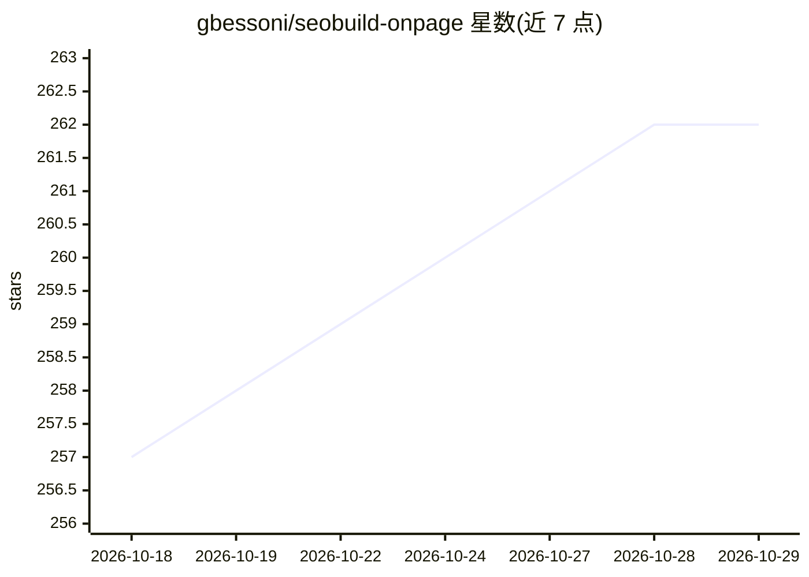

# gbessoni/seobuild-onpage

⭐ 262 · Python · 推送 2026-10-20 · [GitHub](https://github.com/gbessoni/seobuild-onpage) · 个人维护

**面向 SEO/GEO 的页面生成 AI agent：一条命令产出可排名页面**

以 Claude Code 插件/skill 形式发布的 SEO 与 GEO 写作 agent（基于 DeerFlow 构建）：通过 /seoagi 命令拉取当前 SERP、分析竞品排名内容与缺口，生成带标题结构、FAQ、schema 标记的完整页面。内置大量写作规则：Two-Gate AEO 引用优化、500-token 分块、实体-事实配对、禁止 NLP 实体堆砌与编造测试声明、DOM 扁平化、74 项质量清单（阈值 63/74）等。也提供 Codex、OpenClaw 与手动克隆的安装方式，接入 GSC/DataForseo 等数据源。

## 筛选速览

| 维度 | 判定 | 备注 |
|---|---|---|
| AI 角色 | `ai-native` | 本体是模型或模型工具 |
| 许可风险 | `none` | — |
| 部署形态 | `library` | 以包/库形式分发 |
| 模型依赖 | locked-api |  |
| 硬件要求 | — | 无带数字的原话,不猜 |
| 安装摩擦 | `low` | 无编译、无系统依赖或容器化 |
| 成熟度 | — | 结构信号不足 |

## 能力要点

- 一条命令拉取 SERP、分析竞品缺口并生成完整页面
- Two-Gate AEO 协议：分别优化候选池入选与引用抽取
- 74 项质量检查清单（通过阈值 63/74）
- 反编造规则：禁止虚构测试数据、禁止 NLP 实体堆砌

## 适用场景

- 按关键词自动生成本地服务或信息类落地页
- 做面向 AI Overviews 与 LLM 引用的 GEO 内容优化
- 从 GSC 数据发现应存在但 404 的 Discovery 路径页面
- 批量产出带 schema 与 FAQ 结构的合规 SEO 页面

## 场景标签

`AI 写作` · 领域:内容生成

## 证据(README 行号)

> L6: claude plugin marketplace add gbessoni/seobuild-onpage && claude plugin install seobuild-onpage@seobuild
> L13: `/seoagi "airport parking JFK"` pulls the current SERP, analyzes what's ranking, finds the gaps in their content, a
> L31: - **The Anti-Hallucination Meta-Directive** -- a new MASTER RULE at the top of SKILL.md. LLMs are trained on fiftee

## 星数曲线

2026-10-18 257 → 2026-10-29 262（+5）

---
*卡片 v1 · prompt 1.4 · 生成 2026-10-22 · 置信度 mid · 依据 README sha `37b8f292c3bc` · [字段定义](../../DATASET.md)*
