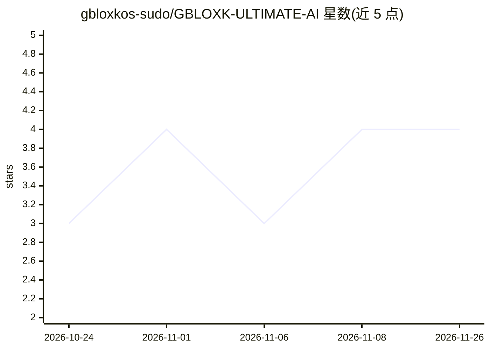

# gbloxkos-sudo/GBLOXK-ULTIMATE-AI

⭐ 4 · Python · NOASSERTION · 推送 2026-10-20 · [GitHub](https://github.com/gbloxkos-sudo/GBLOXK-ULTIMATE-AI) · 组织维护

**面向授权安全测试者的全本地 AI 助手（聊天/RAG/渗透）**

以 Ollama 本地模型为后端运行的 AI 助手，整合聊天/补全、文档 RAG（txt/md/pdf）、3 步自主 agent、内置免费侦察扫描（子域/DNS/nmap/端口/SSL/CORS）与 AI 报告生成，并提供带 sudo 的 Python/shell 实验环境、网站爬虫与浏览器页面 AI 分析。面向防御性安全、研究与授权评估场景。要求 Linux、Python 3.10+ 与 Ollama，支持裸机脚本安装或 Docker 部署，默认端口 5050。README 附授权声明：仅测试自拥有或获授权的目标。

## 筛选速览

| 维度 | 判定 | 备注 |
|---|---|---|
| AI 角色 | `ai-native` | 本体是模型或模型工具 |
| 许可风险 | `none` | NOASSERTION |
| 部署形态 | `self-host` | docker 或自建部署 |
| 模型依赖 | local-ok | 支持本地模型 |
| 硬件要求 | — | 无带数字的原话,不猜 |
| 安装摩擦 | `low` | 无编译、无系统依赖或容器化 |
| 成熟度 | — | 结构信号不足 |

## 能力要点

- 100% 本地 Ollama 模型运行，无云端密钥/付费 API/遥测
- 内置免费侦察工具链：子域/DNS 爆破/WHOIS/nmap/SSL/CORS 检查
- RAG 支持本地 txt/md/pdf 文档与多种 AI 报告生成
- 带 sudo 的 Python/shell 实验环境与 3 步自主 agent

## 适用场景

- 对自己拥有或授权的目标做自动化侦察与渗透测试
- 在本地离线环境运行聊天、补全与文档 RAG 问答
- 爬取网站并生成技术栈与页面 AI 分析报告

## 场景标签

`网络安全` `RAG` `AI 助手` `网页抓取` · 领域:效率与自动化

## 证据(README 行号)

> L7: GBLOXKOS is a 100% local, free AI assistant that unifies:
> L18: Runs entirely on local **Ollama** models. No cloud keys, no paid APIs, no telemetry.

## 星数曲线

2026-10-24 3 → 2026-11-26 4（+1）

---
*卡片 v1 · prompt 1.4 · 生成 2026-11-21 · 置信度 high · 依据 README sha `56935b5f5aa2` · [字段定义](../../DATASET.md)*
