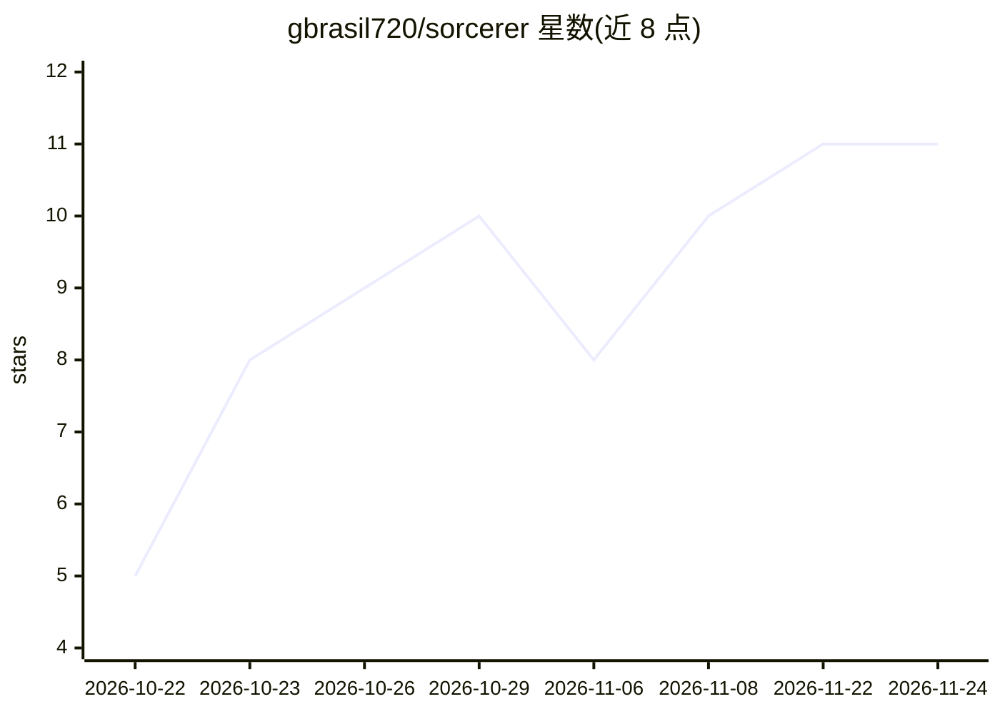

# gbrasil720/sorcerer

⭐ 11 · Swift · MIT · 推送 2026-10-26 · [GitHub](https://github.com/gbrasil720/sorcerer) · [官网](https://sorcererapp.dev) · 个人维护

**macOS 本地应用：模拟 AI agent 社区演绎 what-if 假设**

基于 SwiftUI 的本地优先 macOS 应用，用户提出一个假设问题后，召出一组各有性格、目标、关系与记忆的 AI 角色社区，按轮次观察观点形成、碰撞与传播。支持暂停、注入事件、任意轮分叉世界并对比结果，报告将每条发现链接到具体帖子。不内置模型，复用本机已登录的 Claude、ChatGPT(Codex)、Gemini CLI 或 Ollama/OpenAI 兼容端点；可将 GitHub 仓库、本地文件夹、网站等转为带 public/insider/hidden 标签的 brief，角色只对已知信息做出反应。README 明确提示模拟结果是待验证的假设，不替代现实证据。

## 筛选速览

| 维度 | 判定 | 备注 |
|---|---|---|
| AI 角色 | `ai-native` | 本体是模型或模型工具 |
| 许可风险 | `permissive` | MIT |
| 部署形态 | `desktop` | 安装包/桌面程序 |
| 模型依赖 | local-ok | 支持本地模型 |
| 硬件要求 | — | 无带数字的原话,不猜 |
| 安装摩擦 | `low` | 无编译、无系统依赖或容器化 |
| 成熟度 | — | 结构信号不足 |

## 能力要点

- AI 角色社区按轮次模拟观点形成与传播，支持分叉世界并对比
- 知识标签机制：brief 按 public/insider/hidden 控制每个角色所知
- 复用本机已登录的 claude/codex/gemini CLI 或 Ollama 本地服务
- CSV 导入角色、定时事件、投票、动作计数与带引用的报告

## 适用场景

- 推演产品调价等决策在社区中可能引发的反应与后果
- 检验一条消息进入群聊后的传播路径
- 创作场景中模拟虚构社区的演化

## 场景标签

`多智能体` · 领域:Agent 开发

## 证据(README 行号)

> L12:  A native, local-first macOS app that simulates communities of AI agents around a "what if…?" question,
> L41: Sorcerer doesn't ship a model or ask for a password. Use a CLI session, a local server, or your own API endpoint:
> L45: |**Claude**|the `claude` CLI (Claude Code)|reads your 5-hour and weekly windows, pauses before you hit them|

## 星数曲线

2026-10-22 5 → 2026-11-24 11（+6）

---
*卡片 v1 · prompt 1.4 · 生成 2026-11-19 · 置信度 high · 依据 README sha `79bb9d87e5d6` · [字段定义](../../DATASET.md)*
