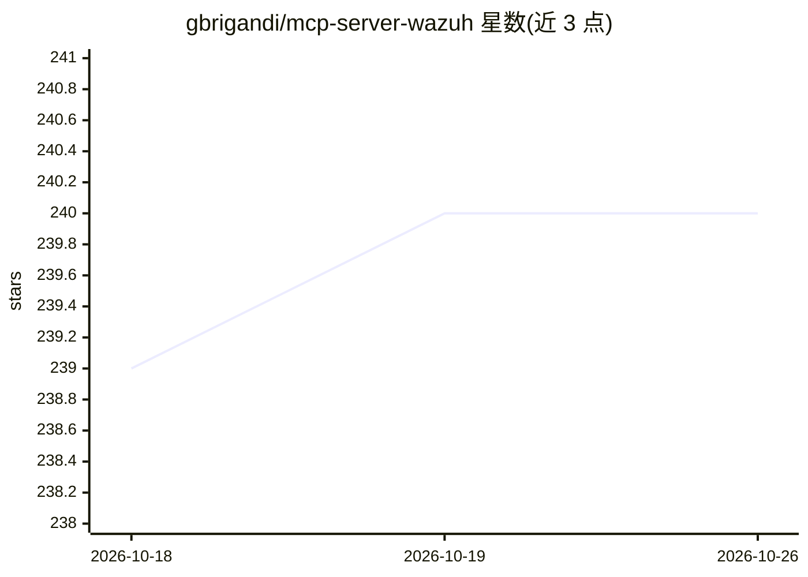

# gbrigandi/mcp-server-wazuh

⭐ 240 · Rust · MIT · 推送 2025-12-12 · [GitHub](https://github.com/gbrigandi/mcp-server-wazuh) · 个人维护

**让 AI 助手用自然语言查询 Wazuh SIEM 安全数据的 MCP 服务器**

Rust 编写的 MCP 服务器，把 Wazuh SIEM 的 API 响应转换为 MCP 格式，供 Claude Desktop 等 MCP 客户端以自然语言访问安全告警、代理管理、漏洞评估、检测规则、日志取证与集群健康等数据，并支持 PCI-DSS、HIPAA、SOX、GDPR 合规监控与差距分析。通过环境变量连接 Wazuh Manager API（推荐 v4.12，端口 55000）与 Wazuh Indexer（端口 9200）。安装方式：下载预编译二进制（Linux/macOS/Windows）、Docker 镜像或 Rust 源码构建。README 提及可与 Cortex/TheHive/MISP 等 MCP 服务器组合用于威胁情报工作流。

## 筛选速览

| 维度 | 判定 | 备注 |
|---|---|---|
| AI 角色 | `ai-ecosystem` | LLM/agent 周边工具 |
| 许可风险 | `permissive` | MIT |
| 部署形态 | `desktop` | 安装包/桌面程序 |
| 模型依赖 | — | README 未给出锁定关系 |
| 硬件要求 | — | 无带数字的原话,不猜 |
| 安装摩擦 | `low` | 无编译、无系统依赖或容器化 |
| 成熟度 | — | 结构信号不足 |

## 能力要点

- 将 Wazuh API 响应转换为 MCP 兼容格式，覆盖告警、漏洞、代理、规则、日志、集群等 8 类数据
- 支持 PCI-DSS/HIPAA/SOA/GDPR 等合规监控与差距分析
- 提供 Linux/macOS(amd64/arm64)/Windows 预编译二进制、Docker 镜像与源码构建三种安装方式
- 通过环境变量配置 Wazuh Manager API 与 Indexer 连接

## 适用场景

- 安全团队用自然语言查询告警、漏洞与代理状态，替代手工 API 调用
- 合规团队快速评估安全态势并生成审计证据
- 结合 Cortex/TheHive/MISP 等 MCP 服务器做威胁情报富化与事件响应

## 场景标签

`网络安全` · 领域:学习与行业

## 证据(README 行号)

> L3: A Rust-based server designed to bridge the gap between a Wazuh Security Information and Event Management (SIEM) syst
> L9: This server transforms complex Wazuh API responses into MCP-compatible format, enabling AI assistants to access:
> L98: - An MCP (Model Context Protocol) compatible LLM client (e.g., Claude Desktop)

## 星数曲线

2026-10-18 239 → 2026-10-26 240（+1）

---
*卡片 v1 · prompt 1.4 · 生成 2026-10-22 · 置信度 high · 依据 README sha `abd4a525e9d9` · [字段定义](../../DATASET.md)*
