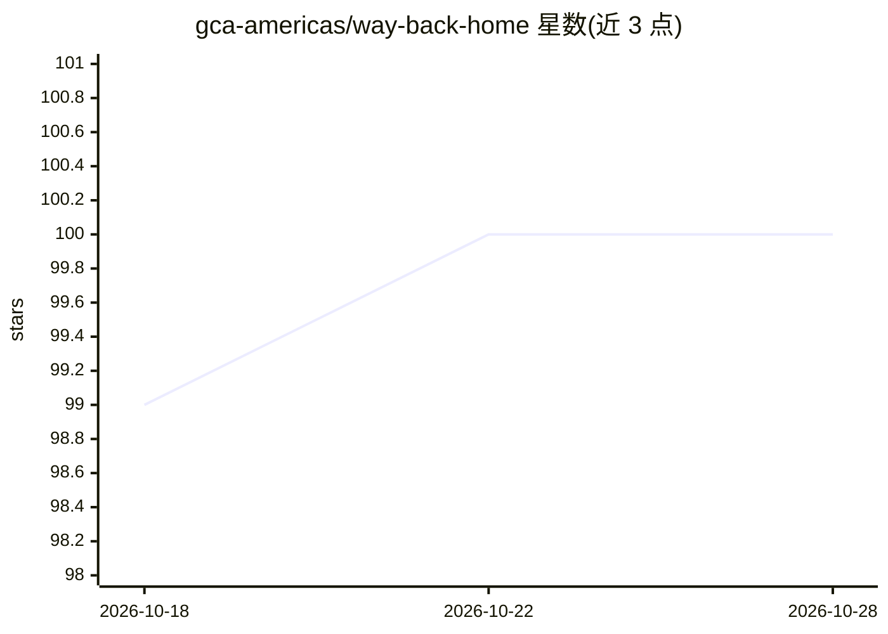

# gca-americas/way-back-home

⭐ 100 · Python · Apache-2.0 · 推送 2026-10-24 · [GitHub](https://github.com/gca-americas/way-back-home) · [官网](https://waybackhome.dev) · 组织维护

**Google Cloud AI 教学工作坊平台：通过救援叙事学构建智能体**

沉浸式 AI 工作坊平台，以太空探险救援为叙事线，分关卡教授 Google Cloud AI 技术：Level 0 用 Gemini 多轮图像生成探险者身份，Level 1 用 Google ADK、MCP 服务器与并行处理做多智能体坠毁点分析，Level 2-5 计划引入事件驱动 agent 与 A2A 通信（标注 coming soon）。技术栈含 Next.js 14/Three.js 前端、FastAPI/Firestore/Cloud Run 后端，供工作坊主办方部署到自有 GCP 项目，参与者经 Cloud Shell 完成关卡，README 附成本估算。

## 筛选速览

| 维度 | 判定 | 备注 |
|---|---|---|
| AI 角色 | `ai-knowledge` | 知识聚合/清单类 |
| 许可风险 | `permissive` | Apache-2.0 |
| 部署形态 | `None` |  |
| 模型依赖 | — | README 未给出锁定关系 |
| 硬件要求 | — | 无带数字的原话,不猜 |
| 安装摩擦 | `low` | 无编译、无系统依赖或容器化 |
| 成熟度 | — | 结构信号不足 |

## 能力要点

- 关卡式课程：图像生成、多智能体、ADK、MCP 等技能点
- 完整前后端架构：Next.js/Three.js 3D 地图 + FastAPI/Cloud Run
- 提供主办方部署指南、活动创建脚本与 API、按参与人数的成本估算
- Level 2-5 的事件驱动 agent 与 A2A 功能标注 coming soon

## 适用场景

- 作为开发者参加工作坊，边闯关边学 Gemini 与多智能体开发
- 工作坊主办方在自有 GCP 项目部署平台并管理活动与参与者
- 通过实时 3D 地图查看全场参与者的救援进度

## 场景标签

`多智能体` `图像生成` `教程课程` · 领域:Agent 开发

## 证据(README 行号)

> L5: **An immersive AI workshop platform where participants learn to build intelligent agents while rescuing a stranded s
> L22: |**Level 0**|Generate your explorer identity|Multi-turn image generation, Gemini (Nano Banana)|
> L23: |**Level 1**|Pinpoint your crash location|Multi-agent systems, MCP servers, ADK, parallel processing|

## 星数曲线

2026-10-18 99 → 2026-10-28 100（+1）

---
*卡片 v1 · prompt 1.4 · 生成 2026-10-23 · 置信度 high · 依据 README sha `12e8d8e609a3` · [字段定义](../../DATASET.md)*
