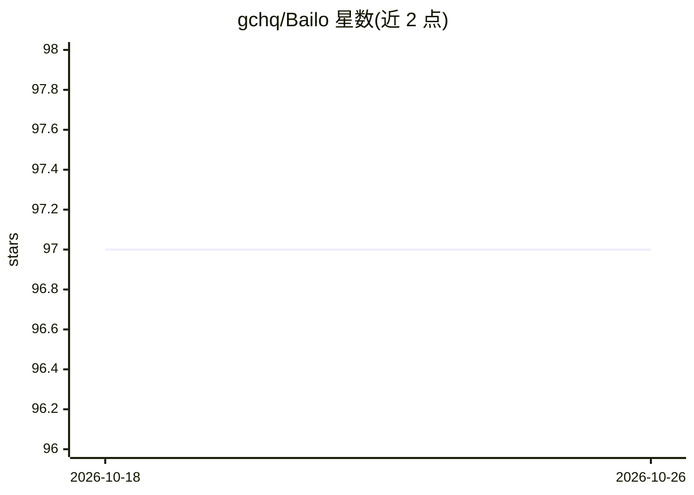

# gchq/Bailo

⭐ 97 · TypeScript · Apache-2.0 · 推送 2026-10-23 · [GitHub](https://github.com/gchq/Bailo) · 组织维护

**管理机器学习生命周期的合规平台（GCHQ 出品）**

由 GCHQ 开发的机器学习生命周期管理平台，支持模型的可扩展性、协作、合规与共享；内置 Docker 镜像仓库、模型/数据卡片与访问请求表单机制，并可与 Stroom 数据平台集成生成事件审计日志（可选）。前端 Next.js/React，后端 Express + MongoDB，文件存储用 SeaweedFS/S3。本地开发与生产均通过 Docker Compose 运行，生产部署推荐 Kubernetes Helm Chart；管理员需自行提供认证方式。

## 筛选速览

| 维度 | 判定 | 备注 |
|---|---|---|
| AI 角色 | `ai-ecosystem` | LLM/agent 周边工具 |
| 许可风险 | `permissive` | Apache-2.0 |
| 部署形态 | `self-host` | docker 或自建部署 |
| 模型依赖 | — | README 未给出锁定关系 |
| 硬件要求 | — | 无带数字的原话,不猜 |
| 安装摩擦 | `low` | 无编译、无系统依赖或容器化 |
| 成熟度 | — | 结构信号不足 |

## 能力要点

- 模型生命周期管理：模型卡片、数据卡片、访问请求表单
- 内置 Docker 镜像仓库与 S3/SeaweedFS 文件存储
- 可选 Stroom 集成，生成事件日志审计轨迹
- 提供 Docker Compose 与 Kubernetes Helm 两种部署方式

## 适用场景

- 团队集中管理、共享机器学习模型并留存审计记录
- 以模型卡片和访问请求表单实现模型发布合规流程
- 在内网 Kubernetes 环境部署自托管模型仓库

## 场景标签

`MLOps` · 领域:训练与推理

## 证据(README 行号)

> L23: Bailo helps you manage the lifecycle of machine learning to support scalability, impact, collaboration, compliance 
> L97: You can test out your new deployment using the example models which can be found in `frontend/cypress/fixtures`

## 星数曲线

2026-10-18 97 → 2026-10-26 97（+0）

---
*卡片 v1 · prompt 1.4 · 生成 2026-10-23 · 置信度 high · 依据 README sha `04e810e5101d` · [字段定义](../../DATASET.md)*
