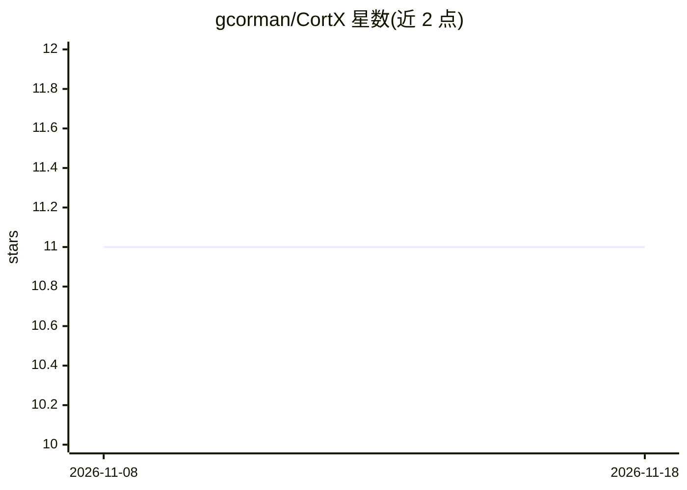

# gcorman/CortX

⭐ 11 · TypeScript · 推送 2026-05-07 · [GitHub](https://github.com/gcorman/CortX) · [官网](https://gcorman.github.io/CortX/) · 个人维护

**本地运行的 AI 第二大脑：语音输入自动结构化为 Markdown 知识库**

Electron 桌面应用，将 Claude Code 式的 agent 范式用于个人知识管理：用户用自然语言输入所见所学，AI agent 识别实体并写入/修改本地 Markdown 文件、建立 wikilink 交叉引用。检索采用 FTS5 全文加嵌入语义的混合 RAG，并沿 wikilink 做多跳扩展；每次被批准的修改生成 Git 提交，可一键回滚。本地运行需配置 Ollama/LM Studio/llama.cpp 端点，或使用 Anthropic/OpenAI API。文档导入（PDF/DOCX 等）依赖可选的 Python docling sidecar，未安装时功能降级。

## 筛选速览

| 维度 | 判定 | 备注 |
|---|---|---|
| AI 角色 | `ai-native` | 本体是模型或模型工具 |
| 许可风险 | `none` | — |
| 部署形态 | `desktop` | 安装包/桌面程序 |
| 模型依赖 | local-ok | 支持本地模型 |
| 硬件要求 | — | 无带数字的原话,不猜 |
| 安装摩擦 | `low` | 无编译、无系统依赖或容器化 |
| 成熟度 | — | 结构信号不足 |

## 能力要点

- AI agent 写写改改 Markdown 文件，所有操作先预览 diff、需用户明确批准
- 混合检索（FTS5 全文 + 嵌入语义）与 wikilink 多跳扩展、隐式反向链接
- 每次批准的操作对应一次 Git 提交，含 agent_log 审计与一键回滚
- 交互式知识图谱（Cytoscape）与 Louvain 聚类的 Galaxy 空间视图

## 适用场景

- 把见闻、人脉、想法口述给 AI，自动归档成带链接的笔记
- 对本地知识库提问并要求引用出处
- 通过 Telegram 机器人随时记录笔记并查询知识库
- 在无云依赖的环境下管理个人知识，数据不出本机

## 场景标签

`知识库管理` `知识图谱` `RAG` · 领域:知识与检索

## 证据(README 行号)

> L8: CortX is a desktop application that applies the **Claude Code** paradigm to personal knowledge management. The user 
> L10: Everything runs **locally** with an open-source model (Ollama, llama.cpp, LM Studio), or via an **API** (Claude, Op
> L64: ### Hybrid Search (RAG) with Multi-hop Expansion

## 星数曲线

2026-11-08 11 → 2026-11-18 11（+0）

---
*卡片 v1 · prompt 1.4 · 生成 2026-11-18 · 置信度 high · 依据 README sha `aa43094902a8` · [字段定义](../../DATASET.md)*
