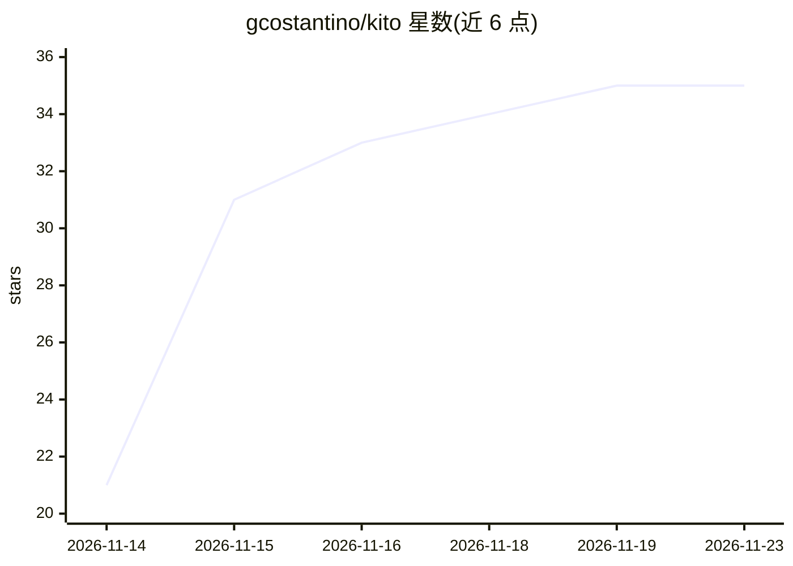

# gcostantino/kito

⭐ 35 · Python · MIT · 推送 2026-11-15 · [GitHub](https://github.com/gcostantino/kito) · [官网](https://kito.readthedocs.io/en/latest/) · 个人维护

**面向科研实验的 PyTorch 训练库：写模型和配置即可自动跑训练**

Kito 是简化深度学习（科研）实验流程的 PyTorch 训练库。用户定义模型模块与配置对象，`Engine` 负责运行训练/验证循环、检查点保存、日志（CSV/文本/TensorBoard）、推理（`predict` 支持多种输入，可写 HDF5）与分布式训练（DDP，支持 torchrun 或自动按 GPU 拉起进程）。数据侧提供 `GenericDataPipeline`、内存/HDF5 数据集、标准化等预处理步骤及防统计泄漏指引；支持自定义回调（含 EarlyStopping）、自定义训练/验证/预测步。需 Python 3.9+，pip 安装。

## 筛选速览

| 维度 | 判定 | 备注 |
|---|---|---|
| AI 角色 | `ai-ecosystem` | LLM/agent 周边工具 |
| 许可风险 | `permissive` | MIT |
| 部署形态 | `library` | 以包/库形式分发 |
| 模型依赖 | — | README 未给出锁定关系 |
| 硬件要求 | — | 无带数字的原话,不猜 |
| 安装摩擦 | `low` | 无编译、无系统依赖或容器化 |
| 成熟度 | — | 结构信号不足 |

## 能力要点

- `Engine` 统一运行训练/验证循环、检查点、日志、推理与 DDP 分布式训练
- 配置驱动：TrainingConfig/ModelConfig/DataConfig 等对象，其余字段有默认值
- 回调系统提供 8 个生命周期钩子，内置 ModelCheckpoint/EarlyStopping/TensorBoard 等
- 推理 `predict` 接受 DataLoader/Dataset/NumPy 数组/张量等多种输入，可保存为 HDF5

## 适用场景

- 科研实验中快速搭建可复现的 PyTorch 训练与验证流程
- 管理多组实验的检查点、日志与输出文件结构
- 单机多卡用 DDP 跑分布式训练而少写样板代码

## 场景标签

`MLOps` · 领域:训练与推理

## 证据(README 行号)

> L14: Kito is a PyTorch training library built to simplify (scientific) experimentation processes of deep learning develo
> L3: **Effortless PyTorch training and (scientific) experimentation - define your model setup, Kito handles the rest.**

## 星数曲线

2026-11-14 21 → 2026-11-23 35（+14）

---
*卡片 v1 · prompt 1.4 · 生成 2026-11-18 · 置信度 high · 依据 README sha `77947648f309` · [字段定义](../../DATASET.md)*
