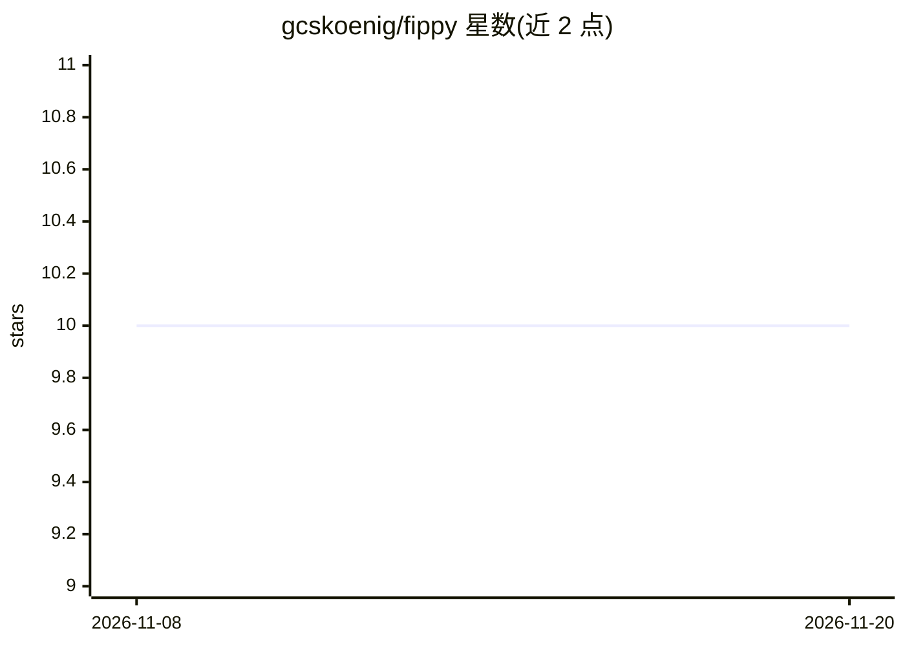

# gcskoenig/fippy

⭐ 10 · Jupyter Notebook · MIT · 推送 2026-03-23 · [GitHub](https://github.com/gcskoenig/fippy) · 个人维护

**模型无关特征重要性 Python 库，含统计推断**

一个 Python 包，提供模型无关的特征重要性计算，支持条件采样与统计推断。方法覆盖 PFI、CFI、RFI、LOCO 与 SAGE，通过归因方式（loo/shapley）、移除方式（resample/marginalize/refit）、参考分布（marginal/conditional）三个维度统一描述；结果对象内置置信区间、特征相关性假设检验（含多重检验校正）、条形图可视化与 CSV 序列化。LOO 方法可用 n_jobs 并行。要求 Python >= 3.11，配套 arXiv 论文，核心 API 稳定但部分采样器仍在规划中。

## 筛选速览

| 维度 | 判定 | 备注 |
|---|---|---|
| AI 角色 | `ai-native` | 本体是模型或模型工具 |
| 许可风险 | `permissive` | MIT |
| 部署形态 | `library` | 以包/库形式分发 |
| 模型依赖 | — | README 未给出锁定关系 |
| 硬件要求 | — | 无带数字的原话,不猜 |
| 安装摩擦 | `low` | 无编译、无系统依赖或容器化 |
| 成熟度 | — | 结构信号不足 |

## 能力要点

- 统一框架实现 PFI/CFI/RFI/LOCO/SAGE 五种重要性方法
- 置信区间与特征相关性假设检验，含 Bonferroni/Holm/BH 多重校正
- 特征可分组联合评估，LOO 方法支持 joblib 线程并行
- 结果可序列化为 CSV 并重新加载

## 适用场景

- 评估已训练模型中各特征对预测损失的贡献
- 需要置信区间与显著性检验的特征重要性分析
- 对相关特征组做整体重要性评估

## 场景标签

`模型评测` · 领域:评测与运维

## 证据(README 行号)

> L8: A Python package for model-agnostic feature importance with support for conditional sampling and statistical inferen
> L190: The package was previously called `rfi` and accompanies our paper on Relative Feature Importance: [[arXiv]](https:

## 星数曲线

2026-11-08 10 → 2026-11-20 10（+0）

---
*卡片 v1 · prompt 1.4 · 生成 2026-11-19 · 置信度 high · 依据 README sha `e69a5160c32d` · [字段定义](../../DATASET.md)*
