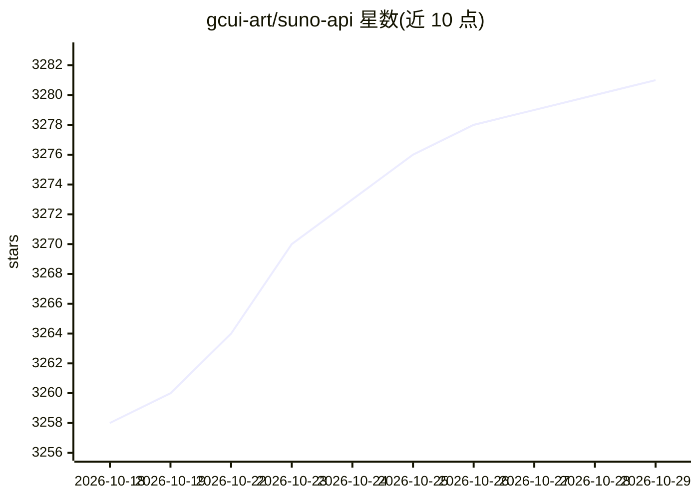

# gcui-art/suno-api

⭐ 3,281 · TypeScript · LGPL-3.0 · 推送 2026-03-06 · [GitHub](https://github.com/gcui-art/suno-api) · [官网](https://suno.gcui.ai) · 个人维护 · 中文 README

**将 Suno.ai 音乐生成能力封装为 API，供 Agent 集成**

非官方开源项目：通过逆向方式调用 Suno.ai 的音乐生成能力，用付费 2Captcha 服务自动解决 hCaptcha，用 Playwright 保持账户活跃，将其封装为自托管 API。API 兼容 OpenAI /v1/chat/completions 格式，支持 Custom Mode（歌词/曲风/标题设置），可部署到 Vercel 或 Docker，也可本地 npm 运行。README 声明仅供学习研究用途，运行需 Suno 账户 Cookie 与 2Captcha API key。

## 筛选速览

| 维度 | 判定 | 备注 |
|---|---|---|
| AI 角色 | `ai-ecosystem` | LLM/agent 周边工具 |
| 许可风险 | `viral` | LGPL-3.0 |
| 部署形态 | `self-host` | docker 或自建部署 |
| 模型依赖 | — | README 未给出锁定关系 |
| 硬件要求 | — | 无带数字的原话,不猜 |
| 安装摩擦 | `low` | 无编译、无系统依赖或容器化 |
| 成熟度 | — | 结构信号不足 |

## 能力要点

- 提供 /api/generate、/v1/chat/completions（OpenAI 兼容格式）等音乐生成 API
- 通过 2Captcha 付费服务与 Playwright 自动处理 hCaptcha
- 支持 Vercel 一键部署、Docker Compose 与本地 npm 运行
- 支持 Custom Mode（自定义歌词、曲风、标题）

## 适用场景

- 把 Suno 音乐生成作为工具/插件/Action 接入 GPTs、Coze 等 Agent 平台
- 以 OpenAI 兼容格式调用音乐生成接口
- 自托管音乐生成 API 服务

## 场景标签

 · 领域:AI 音乐生成/API 服务

## 证据(README 行号)

> L3:  Use API to call the music generation AI of Suno.ai and easily integrate it into agents like GPTs.
> L37: - Compatible with the format of OpenAI’s `/v1/chat/completions` API.
> L40: - In addition to the standard API, it also adapts to the API Schema of Agent platforms like GPTs and Coze, so you c

## 星数曲线

2026-10-18 3,258 → 2026-10-29 3,281（+23）

---
*卡片 v1 · prompt 1.4 · 生成 2026-10-20 · 置信度 high · 依据 README sha `0bc8b2e56499` · [字段定义](../../DATASET.md)*
