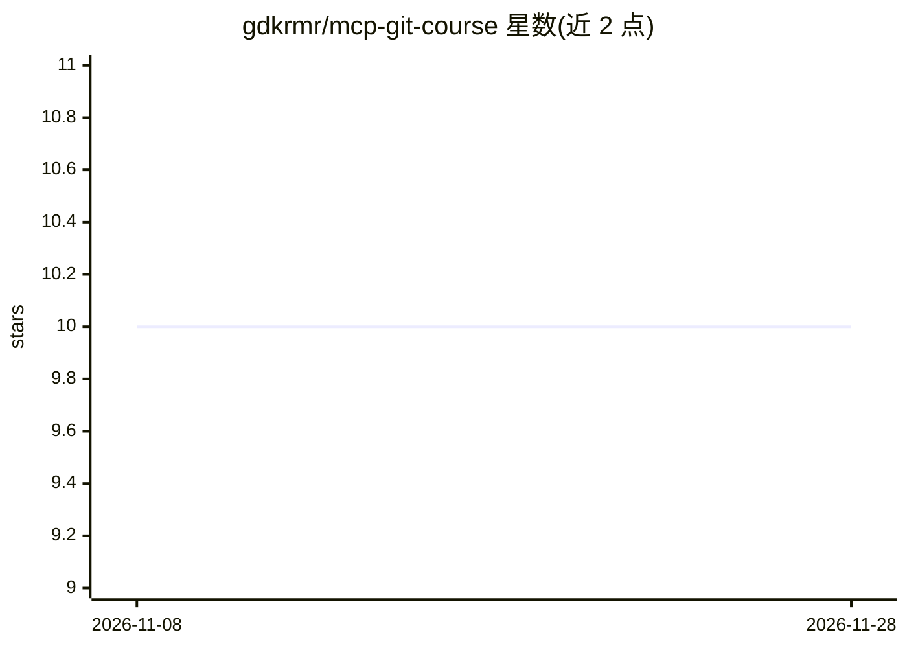

# gdkrmr/mcp-git-course

⭐ 10 · Python · Apache-2.0 · 推送 2026-01-22 · [GitHub](https://github.com/gdkrmr/mcp-git-course) · 个人维护

**通过本地 LLM 客户端交互式学习 git 的 MCP 课程服务器**

一个以 MCP 服务器形式发布的 git 课程仓库：向用户的本地 LLM 客户端提供课程材料与教学指令，由 LLM 引导用户逐步学习 git。服务器跟踪学习进度，支持恢复课程、重启课程，并在 LLM 混乱时跳转到任意课程。使用前提是有一个支持 MCP 的本地客户端（如 Zed、Claude Code、VS Code、Gemini CLI）。安装途径为 pipx 安装或 uvx 直接运行；README 另提供不借助 LLM 手动阅读课程材料的方式。

## 筛选速览

| 维度 | 判定 | 备注 |
|---|---|---|
| AI 角色 | `ai-native` | 本体是模型或模型工具 |
| 许可风险 | `permissive` | Apache-2.0 |
| 部署形态 | `None` |  |
| 模型依赖 | — | README 未给出锁定关系 |
| 硬件要求 | — | 无带数字的原话,不猜 |
| 安装摩擦 | `low` | 无编译、无系统依赖或容器化 |
| 成熟度 | — | 结构信号不足 |

## 能力要点

- 以 MCP 服务器形式提供 git 课程材料与教学指令
- 跟踪学习进度，支持恢复、重启与跳转课程
- 提供 Zed、VS Code、Gemini CLI 等客户端的配置说明
- 课程材料可脱离 LLM 直接阅读

## 适用场景

- 借助本地 LLM 客户端交互式学习 git
- 中断后从上次进度继续课程
- 为支持 MCP 的客户端接入一个教学类服务器

## 场景标签

`教程课程` · 领域:学习与行业

## 证据(README 行号)

> L7: - This repository contains an MCP server that instructs your LLM client teach you `git`. It contains course material
> L21: A local LLM client that supports MCP servers, such as Zed, Claude code, VS Code, or Gemini.

## 星数曲线

2026-11-08 10 → 2026-11-28 10（+0）

---
*卡片 v1 · prompt 1.4 · 生成 2026-11-19 · 置信度 high · 依据 README sha `4beff973ecd5` · [字段定义](../../DATASET.md)*
