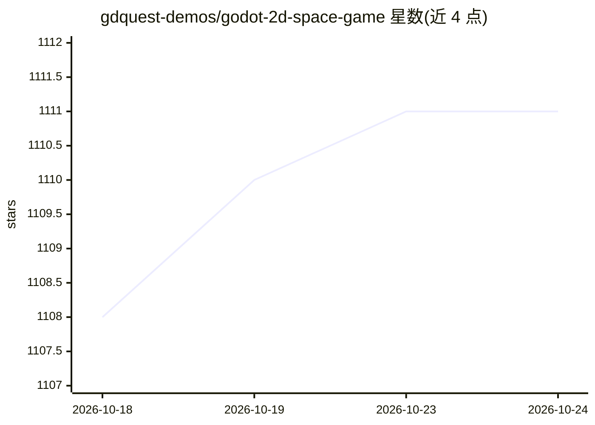

# gdquest-demos/godot-2d-space-game

⭐ 1,111 · GDScript · NOASSERTION · 推送 2026-05-16 · [GitHub](https://github.com/gdquest-demos/godot-2d-space-game) · 组织维护

**Godot 制作的俯视角太空采矿开源游戏**

一款基于 Godot 引擎的免费开源俯视角太空采矿游戏：玩家驾驶飞船在程序化生成的小行星带中采矿、运送铁矿石回空间站换取升级（血量、速度、货舱、武器伤害）。海盗敌人会随玩家存入货物而刷出，追踪玩家并规避小行星。游戏内 AI 包括基于 Godot Steering AI Framework 的敌人移动与对接自动驾驶（按 E 后 AI 接管船只入位锁定）。面向游戏玩家与 Godot 学习者，GDQuest 同时提供游戏开发教程与课程。

## 筛选速览

| 维度 | 判定 | 备注 |
|---|---|---|
| AI 角色 | `ai-enhanced` | 去掉 AI 部分产品仍成立 |
| 许可风险 | `none` | NOASSERTION |
| 部署形态 | `None` |  |
| 模型依赖 | — | README 未给出锁定关系 |
| 硬件要求 | — | 无带数字的原话,不猜 |
| 安装摩擦 | `low` | 无编译、无系统依赖或容器化 |
| 成熟度 | — | 结构信号不足 |

## 能力要点

- 程序化生成大地图与小行星矿区
- 基于 Godot Steering AI Framework 的海盗追踪与避障行为
- 按 E 对接时 AI 接管飞船入位锁定
- 采矿—交付—升级的循环玩法

## 适用场景

- 游玩太空采矿与对抗海盗的休闲游戏
- 学习 Godot 引擎与 steering AI 的游戏开发示例

## 场景标签

`教程课程` · 领域:学习与行业

## 证据(README 行号)

> L5: Harvester is a Free and Open-Source top-down space mining game made with the Godot game engine. Control your spacesh
> L25: The game uses the Godot Steering AI Framework while still being a fun time waster.
> L31: - Dock with E : When approaching an asteroid or a station, the player can activate docking mode, and an AI will tak

## 星数曲线

2026-10-18 1,108 → 2026-10-24 1,111（+3）

---
*卡片 v1 · prompt 1.4 · 生成 2026-10-21 · 置信度 mid · 依据 README sha `e73fec3571c3` · [字段定义](../../DATASET.md)*
