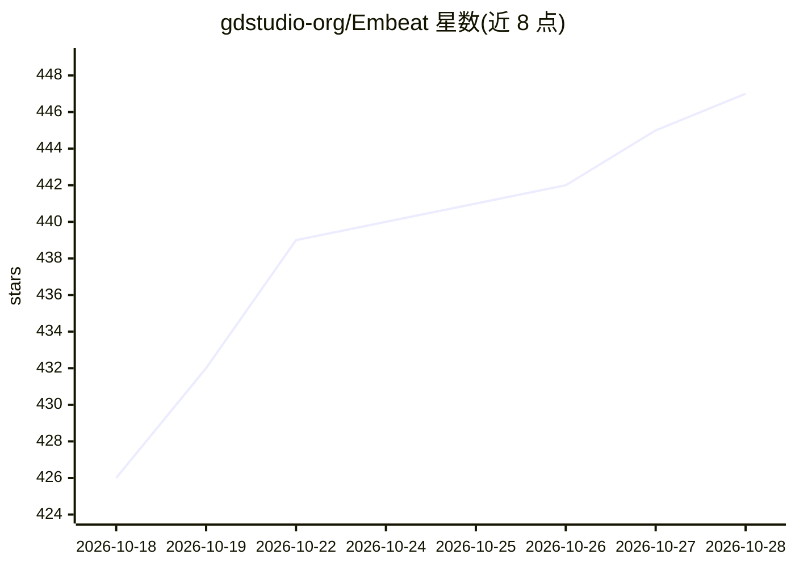

# gdstudio-org/Embeat

⭐ 447 · Python · NOASSERTION · 推送 2026-09-24 · [GitHub](https://github.com/gdstudio-org/Embeat) · [官网](https://music.gdstudio.xyz) · 组织维护 · 中文 README

**基于声学特征的歌曲相似推荐系统（Spotify 曲库）**

Embeat 是 item-to-item 音乐推荐系统：自研 EmbeatMLP 将 Spotify 音频特征（调性、节奏、能量等）编码为 64 维声学向量，Track2Vec（Word2Vec Skip-Gram）从 188 万 Spotify 播放列表学习歌曲共现，配合 5 通道召回（声学相似/同流派热门/同艺人/相似艺人/播放列表协同过滤）输出相似歌曲。支持以 Spotify track ID、ISRC、歌名+艺人等方式检索种子曲目；推理可 CPU-only，模型训练需 PyTorch 与 CUDA。README 给出 LLM-as-a-Judge 对比网易云音乐的盲评结果。

## 筛选速览

| 维度 | 判定 | 备注 |
|---|---|---|
| AI 角色 | `ai-native` | 本体是模型或模型工具 |
| 许可风险 | `none` | NOASSERTION |
| 部署形态 | `None` |  |
| 模型依赖 | — | README 未给出锁定关系 |
| 硬件要求 | `cpu-ok` | |
| 安装摩擦 | `medium` | 含编译或系统依赖之一 |
| 成熟度 | — | 结构信号不足 |

## 能力要点

- EmbeatMLP 声学特征编码（对比学习，64 维向量，支持实时 CPU 推理）
- Track2Vec 基于 188 万 Spotify 播放列表的协同过滤
- 5 通道召回合并打分，覆盖 6,291 微流派标签
- 支持 Spotify track ID / ISRC / 歌名+艺人多方式检索

## 适用场景

- 以一首歌为种子获取相似歌曲推荐
- 自建音乐推荐服务（可部署于 2GB 内存 VPS）
- 复现训练声学编码与播放列表协同过滤模型

## 场景标签

`推荐系统` · 领域:学习与行业

## 证据(README 行号)

> L18: Embeat is a music recommendation system built on Spotify acoustic feature data. It encodes audio features into vect
> L22: - **In-house models**: EmbeatMLP encodes Spotify Audio Features (key, tempo, energy, mood, etc.) into 64-dimensiona

## 星数曲线

2026-10-18 426 → 2026-10-28 447（+21）

---
*卡片 v1 · prompt 1.4 · 生成 2026-10-21 · 置信度 high · 依据 README sha `e1088977fb79` · [字段定义](../../DATASET.md)*
