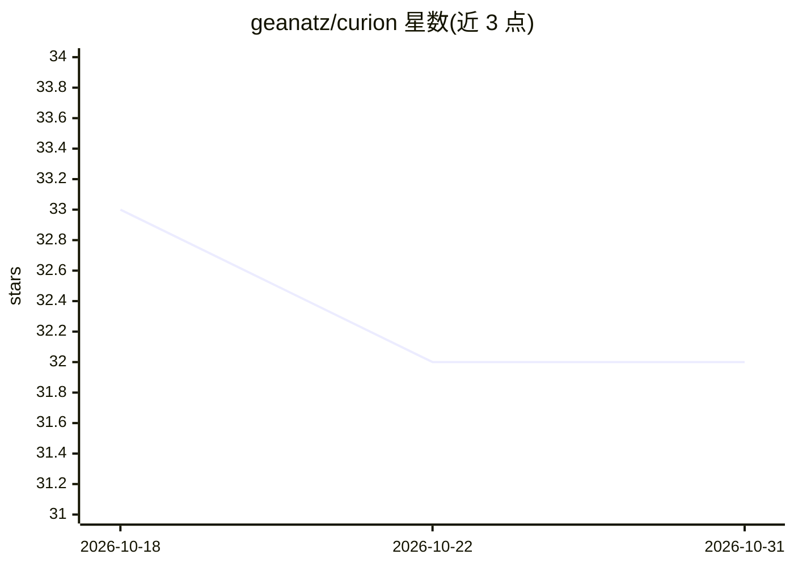

# geanatz/curion

⭐ 32 · TypeScript · Apache-2.0 · 推送 2026-07-21 · [GitHub](https://github.com/geanatz/curion) · [官网](https://www.npmjs.com/package/@geanatz/curion) · 个人维护

**AI 编码 agent 的项目级持久记忆层（MCP stdio 服务器）**

以 MCP stdio 服务器形式运行的项目本地记忆层，供 Claude Code、Codex CLI、OpenCode 等 MCP 客户端作为子进程启动。公开 API 仅两个工具：remember(text) 存储项目记忆，recall(text) 检索相关内容；记忆以 SQLite 形式存储在项目内 .curion/ 目录，不发送到共享后端，可通过 config.json 标记项目私有。原始输入不被持久化，仅存储控制器归一化摘要与元数据。提供商可插拔（OpenAI 兼容为默认，或 Anthropic），需通过环境变量配置 API key，不加载 .env 文件。npm 全局安装，需 Node.js >= 22。

## 筛选速览

| 维度 | 判定 | 备注 |
|---|---|---|
| AI 角色 | `ai-ecosystem` | LLM/agent 周边工具 |
| 许可风险 | `permissive` | Apache-2.0 |
| 部署形态 | `library` | 以包/库形式分发 |
| 模型依赖 | locked-api |  |
| 硬件要求 | — | 无带数字的原话,不猜 |
| 安装摩擦 | `low` | 无编译、无系统依赖或容器化 |
| 成熟度 | — | 结构信号不足 |

## 能力要点

- 仅两个工具的冻结公开 API：remember(text) / recall(text)
- 项目本地 SQLite 存储（.curion/），记忆不上传共享后端
- 仅持久化归一化摘要而非原始输入，带安全过滤
- 可插拔提供商：OpenAI 兼容（默认）或 Anthropic，可选语义检索

## 适用场景

- 让编码 agent 跨会话记住设计决策与团队约定
- 在多个 MCP 客户端（Claude Code/Codex/OpenCode）中共享同一项目记忆
- 私有项目配置隔离，避免跨项目检索暴露

## 场景标签

`Agent 记忆` · 领域:Agent 开发

## 证据(README 行号)

> L9: > **Project-local memory layer for AI agents, exposed as a Model Context Protocol (MCP) stdio server.**
> L16: It runs as a local MCP stdio server that any compatible client can spawn.

## 星数曲线

2026-10-18 33 → 2026-10-31 32（-1）

---
*卡片 v1 · prompt 1.4 · 生成 2026-10-26 · 置信度 high · 依据 README sha `810b66f411e2` · [字段定义](../../DATASET.md)*
