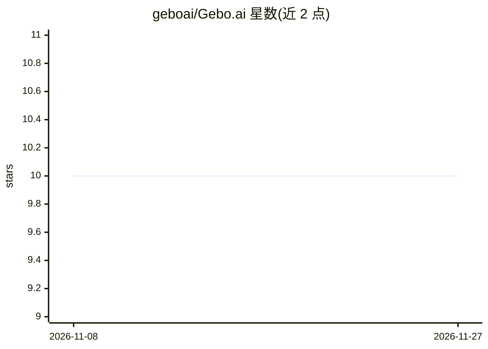

# geboai/Gebo.ai

⭐ 10 · Java · NOASSERTION · 推送 2026-11-26 · [GitHub](https://github.com/geboai/Gebo.ai) · [官网](https://gebo.ai/) · 组织维护

**企业自托管的厂商中立 AI/RAG 平台，接入企业系统供文档问答**

开源的企业级检索增强生成平台，可部署在公司内部，对接 Confluence、Jira、SharePoint/OneDrive、Google Drive、Git、S3 等文档源构建知识库。管理端可配置多家 LLM 提供商（含 Ollama/vLLM 本地模型）、Web 搜索提供商、SSO 登录与合规审计；支持在管理控制台无代码编排 AI agent 网络，内置用量/成本看板与 NIS2 取向审计日志。通过 docker-compose、Ubuntu/Windows 包或 appliance 安装。

## 筛选速览

| 维度 | 判定 | 备注 |
|---|---|---|
| AI 角色 | `ai-ecosystem` | LLM/agent 周边工具 |
| 许可风险 | `none` | NOASSERTION |
| 部署形态 | `desktop` | 安装包/桌面程序 |
| 模型依赖 | local-ok | 支持本地模型 |
| 硬件要求 | — | 无带数字的原话,不猜 |
| 安装摩擦 | `low` | 无编译、无系统依赖或容器化 |
| 成熟度 | — | 结构信号不足 |

## 能力要点

- 多提供商 LLM 配置，兼容 OpenAI API 的任意服务，支持 Ollama/vLLM 本地模型
- 无代码编排 agent 网络与可视化图编排，支持 MCP 与 A2A 协议双向互通
- 多源知识库管理、GraphRag（neo4j）、重排序/图像/语音模型配置
- 用量与成本看板、token 限额、Wazuh 兼容审计日志与 GDPR 数据流登记

## 适用场景

- 为企业内部技术文档搭建带权限控制的 RAG 问答机器人
- 给客服团队部署面向客户的知识库聊天机器人
- 在企业内网用本地模型避免数据出境的 LLM 接入
- 集中监控各部门 LLM 用量与成本并设限额

## 场景标签

`聊天机器人` `文档问答` `RAG` · 领域:对话与助手

## 证据(README 行号)

> L3: This software is an open source enterprise AI and retrieve augmented generation platform that can be installed in ev
> L5: It's a "No AI vendor lock-in" alternative to cloud vendors platform, it can work with almost all cloud or on premise
> L38:  - Connect to **Model Context Protocol (MCP)** servers to give your chatbots extra tools & data sources, or expose 

## 星数曲线

2026-11-08 10 → 2026-11-27 10（+0）

---
*卡片 v1 · prompt 1.4 · 生成 2026-11-19 · 置信度 high · 依据 README sha `a4df446105ef` · [字段定义](../../DATASET.md)*
