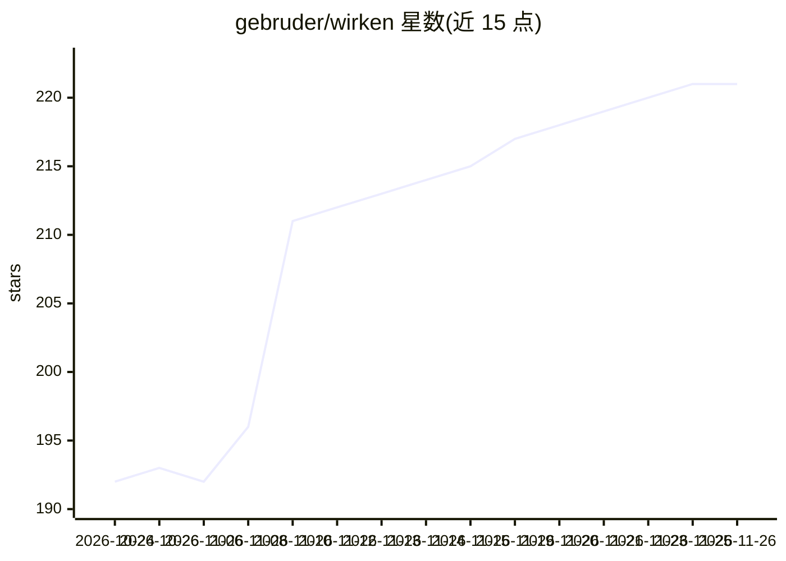

# gebruder/wirken

⭐ 221 · Rust · MIT · 推送 2026-11-25 · [GitHub](https://github.com/gebruder/wirken) · [官网](https://wirken.ai) · 组织维护

**面向企业的自主代理安全网关：隔离、凭证保管与审计**

Rust 编写的单文件静态二进制网关，位于团队消息渠道与 AI 代理之间：Telegram/Slack/Teams/Matrix 等渠道各有独立适配器进程，代理读文件、调 API、执行工具均先过权限门控。凭证存于加密 vault，不暴露给模型；每条工具调用写入哈希链审计日志并签名；shell 命令默认在无网络容器沙箱执行；支持三级权限模型与按代理的预算上限。模型连接与具体厂商无关，可为本地权重或各类 API。MIT 许可，提供 WebChat UI、代理模式与定时预设。

## 筛选速览

| 维度 | 判定 | 备注 |
|---|---|---|
| AI 角色 | `ai-ecosystem` | LLM/agent 周边工具 |
| 许可风险 | `permissive` | MIT |
| 部署形态 | `None` |  |
| 模型依赖 | local-ok | 支持本地模型 |
| 硬件要求 | — | 无带数字的原话,不猜 |
| 安装摩擦 | `low` | 无编译、无系统依赖或容器化 |
| 成熟度 | — | 结构信号不足 |

## 能力要点

- 哈希链审计日志，签名链头可离线核验
- 凭证保存在加密 vault，代理与模型不可见
- shell 命令默认在无网络容器沙箱中运行
- 代理模式为外部代理记录并门控模型与 MCP 调用

## 适用场景

- 安全团队为代理行为提供可追责的审计记录
- 让代理通过企业现有聊天渠道工作且不接触密钥
- 限制被攻陷代理可触碰的凭据与网络出口

## 场景标签

`网络安全` `模型网关` · 领域:Agent 开发

## 证据(README 行号)

> L7: Wirken is the enterprise gateway for autonomous agents: the switchboard
> L13: It also stands in front of agents it does not run. A coding agent or a script
> L44: - **Every action is logged and attributed.** Each tool call is written to a

## 星数曲线

2026-10-24 192 → 2026-11-26 221（+29）

---
*卡片 v1 · prompt 1.4 · 生成 2026-11-25 · 置信度 high · 依据 README sha `6cc9c5139796` · [字段定义](../../DATASET.md)*
