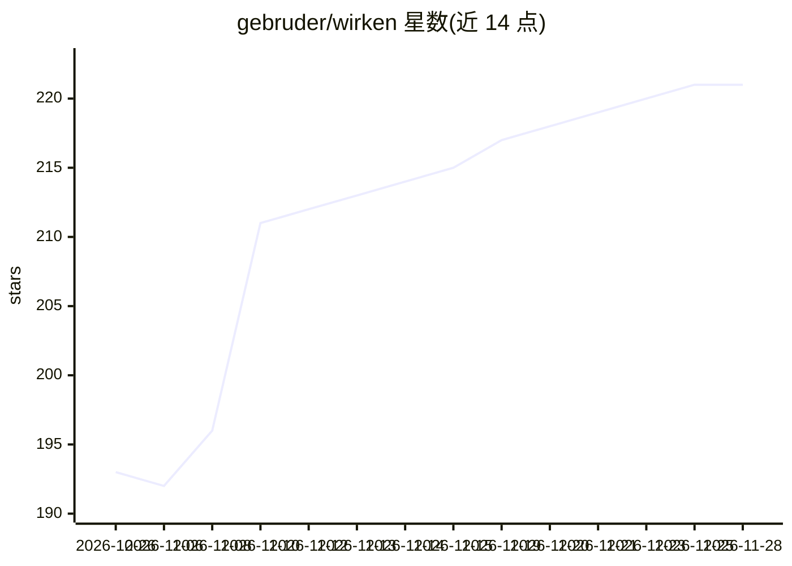

# gebruder/wirken

⭐ 221 · Rust · MIT · 推送 2026-11-27 · [GitHub](https://github.com/gebruder/wirken) · [官网](https://wirken.ai) · 组织维护

**为自主 agent 提供身份、隔离、凭据保管与审计的企业网关**

Wirken 是位于团队消息渠道与 AI agent 之间的网关：支持 Telegram/Discord/Slack/Teams 等渠道接入，提供加密凭据保管（密钥不进入模型上下文）、每渠道进程隔离、哈希链审计日志（含签名链头）、三级权限模型与默认无网络容器沙箱。另以代理模式为外部 agent 的模型调用与 MCP 工具调用提供同样的门控与记录。以单个静态 Rust 二进制发布，MIT 许可，支持 Linux/macOS/Windows，模型端点 provider 无关。

## 筛选速览

| 维度 | 判定 | 备注 |
|---|---|---|
| AI 角色 | `ai-ecosystem` | LLM/agent 周边工具 |
| 许可风险 | `permissive` | MIT |
| 部署形态 | `None` |  |
| 模型依赖 | local-ok | 支持本地模型 |
| 硬件要求 | — | 无带数字的原话,不猜 |
| 安装摩擦 | `low` | 无编译、无系统依赖或容器化 |
| 成熟度 | — | 结构信号不足 |

## 能力要点

- 凭据存于加密 vault，agent 与 LLM 不接触密钥
- 哈希链审计日志，支持签名链头与离机密钥校验
- 默认在无网络临时容器中执行 shell 命令
- 代理模式为外部 agent 的模型与 MCP 调用提供记录与门控

## 适用场景

- 安全团队为接入消息渠道的 agent 设置权限与审计
- 将凭据与模型隔离，防止提示注入后凭据泄露
- 让外部编码 agent 的调用经统一网关记录与审批

## 场景标签

 · 领域:LLM 基础设施/agent 安全网关

## 证据(README 行号)

> L7: Wirken is the enterprise gateway for autonomous agents: the switchboard
> L59: - **Clients Wirken does not run get the same record and the same gate.** In
> L236: - **Proxy.** A client outside Wirken authenticates with a token the operator

## 星数曲线

2026-10-26 193 → 2026-11-28 221（+28）

---
*卡片 v1 · prompt 1.4 · 生成 2026-11-28 · 置信度 high · 依据 README sha `d79f7735dd95` · [字段定义](../../DATASET.md)*
