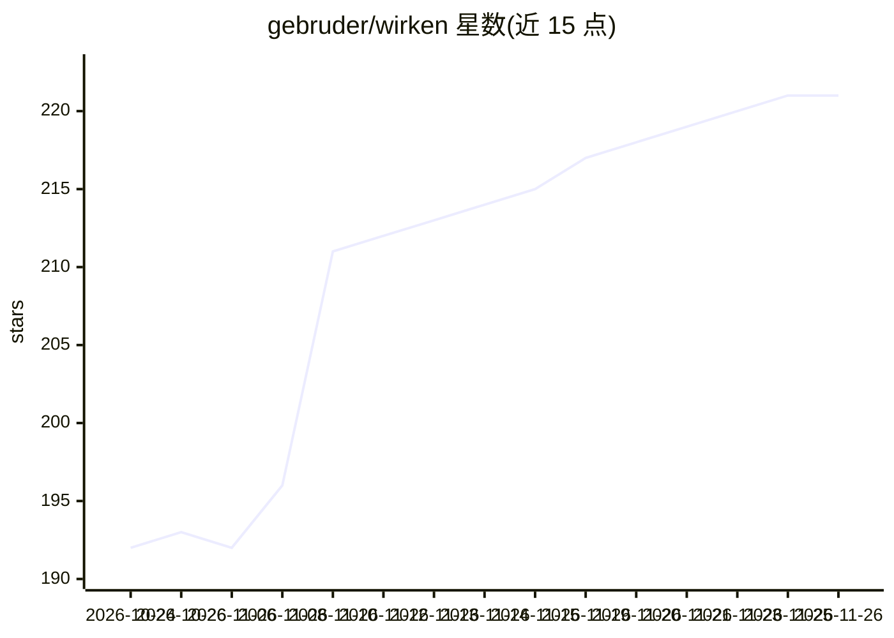

# gebruder/wirken

⭐ 221 · Rust · MIT · 推送 2026-11-25 · [GitHub](https://github.com/gebruder/wirken) · [官网](https://wirken.ai) · 个人维护

**自主 Agent 的企业安全网关：身份、隔离、凭据保管与审计**

面向企业安全团队的 Agent 网关，充当消息渠道（Telegram/Slack/Teams/Matrix 等）与 AI Agent 之间的交换机。每个渠道独立进程隔离，凭据存于加密保管库且模型不可见，每个工具调用写入哈希链审计日志，shell 命令默认在无网络容器沙箱执行。单个静态 Rust 二进制分发，模型连接 provider 无关（API、Ollama 本地权重均可），支持代理模式为外部 MCP 客户端提供同样的门控与记录。Docker 为沙箱默认前置条件。

## 筛选速览

| 维度 | 判定 | 备注 |
|---|---|---|
| AI 角色 | `ai-ecosystem` | LLM/agent 周边工具 |
| 许可风险 | `permissive` | MIT |
| 部署形态 | `None` |  |
| 模型依赖 | local-ok | 支持本地模型 |
| 硬件要求 | — | 无带数字的原话,不猜 |
| 安装摩擦 | `low` | 无编译、无系统依赖或容器化 |
| 成熟度 | — | 结构信号不足 |

## 能力要点

- 加密凭据保管库：token 与密钥不经过模型与 Agent
- 哈希链审计日志，签名链头可离机验证（audit verify）
- 三级权限模型与每次询问的操作员审批流
- 默认无网络容器沙箱与 per-agent 预算上限

## 适用场景

- 为接入消息渠道的企业 Agent 统一做权限审批与审计
- 安全团队管控可能被提示注入的不可信 Agent
- 以代理模式为外部编码 Agent 记录模型调用并门控 MCP 工具调用

## 场景标签

`网络安全` · 领域:学习与行业

## 证据(README 行号)

> L7: Wirken is the enterprise gateway for autonomous agents: the switchboard
> L14: points its model base URL and its MCP client at Wirken and holds a Wirken
> L59: - **Clients Wirken does not run get the same record and the same gate.** In

## 星数曲线

2026-10-24 192 → 2026-11-26 221（+29）

---
*卡片 v1 · prompt 1.4 · 生成 2026-11-26 · 置信度 high · 依据 README sha `1e7df9e366a6` · [字段定义](../../DATASET.md)*
