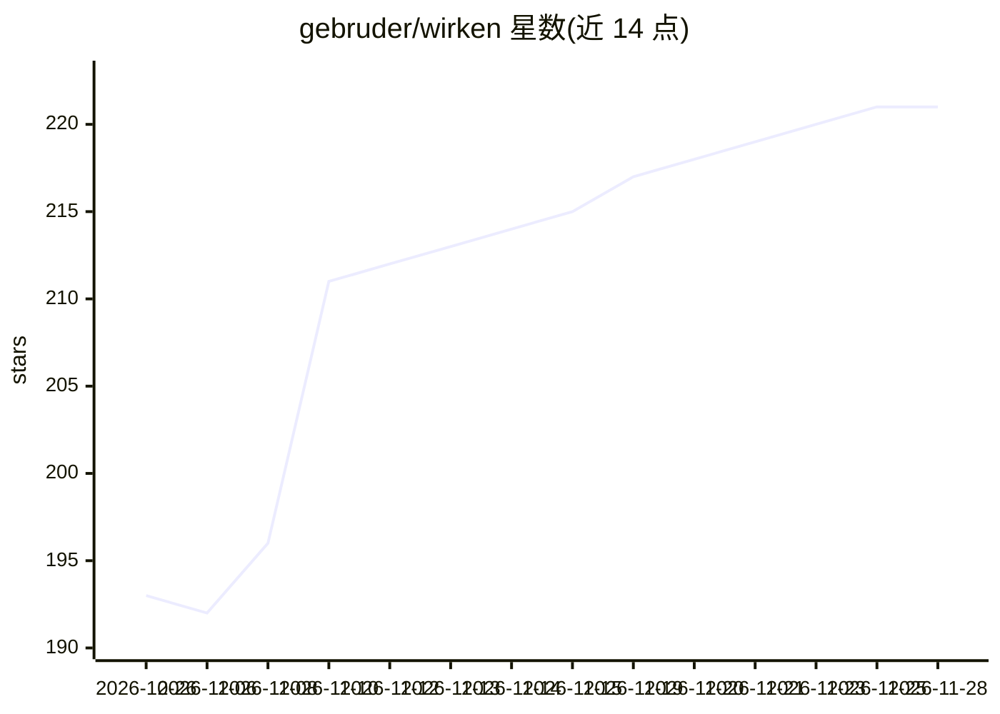

# gebruder/wirken

⭐ 221 · Rust · MIT · 推送 2026-11-27 · [GitHub](https://github.com/gebruder/wirken) · [官网](https://wirken.ai) · 组织维护

**企业级 agent 网关：为自主 agent 提供隔离、审计与凭证管理**

Wirken 是连接团队消息渠道与 AI agent 的企业网关：用户通过浏览器或既有聊天平台发起请求，agent 代为读文件、调 API、运行工具，每次操作先过网关控制。核心机制包括加密凭证保管库（token/key 不送达模型与 agent）、哈希链审计日志、三层最小权限模型、默认在无网络的一次性容器沙箱中执行 shell 命令，以及按 agent 预算上限告警或拒绝调用。以单个静态 Rust 二进制分发，模型连接 provider-agnostic（云端 API 或 Ollama 本地权重等），面向需要为 agent 行为负责的安全团队。

## 筛选速览

| 维度 | 判定 | 备注 |
|---|---|---|
| AI 角色 | `ai-ecosystem` | LLM/agent 周边工具 |
| 许可风险 | `permissive` | MIT |
| 部署形态 | `None` |  |
| 模型依赖 | local-ok | 支持本地模型 |
| 硬件要求 | — | 无带数字的原话,不猜 |
| 安装摩擦 | `low` | 无编译、无系统依赖或容器化 |
| 成熟度 | — | 结构信号不足 |

## 能力要点

- 凭证保管库：agent 与 LLM 永远看不到 token/key，由网关在边界注入
- 哈希链审计日志，签名链头可离线校验（wirken audit verify）
- shell 命令默认在无网络的一次性容器中执行，出网走代理白名单审批
- 代理模式：未由 Wirken 运行的客户端的模型调用与 MCP 工具调用走同一道门并逐条记录

## 适用场景

- 安全团队为接入 Slack/Teams 等渠道的 agent 设权限与审计
- 让外部 coding agent 指向 Wirken 代理端点，替换 provider 密钥并记录调用
- 在气隙主机或内网服务器上运行受控 agent

## 场景标签

`网络安全` · 领域:学习与行业

## 证据(README 行号)

> L7: Wirken is the enterprise gateway for autonomous agents: the switchboard
> L22: It ships as a single static Rust binary, so it runs wherever your controls
> L48: - **Least privilege by default.** A [three-tier permission

## 星数曲线

2026-10-26 193 → 2026-11-28 221（+28）

---
*卡片 v1 · prompt 1.4 · 生成 2026-11-27 · 置信度 high · 依据 README sha `773552ecb0e5` · [字段定义](../../DATASET.md)*
