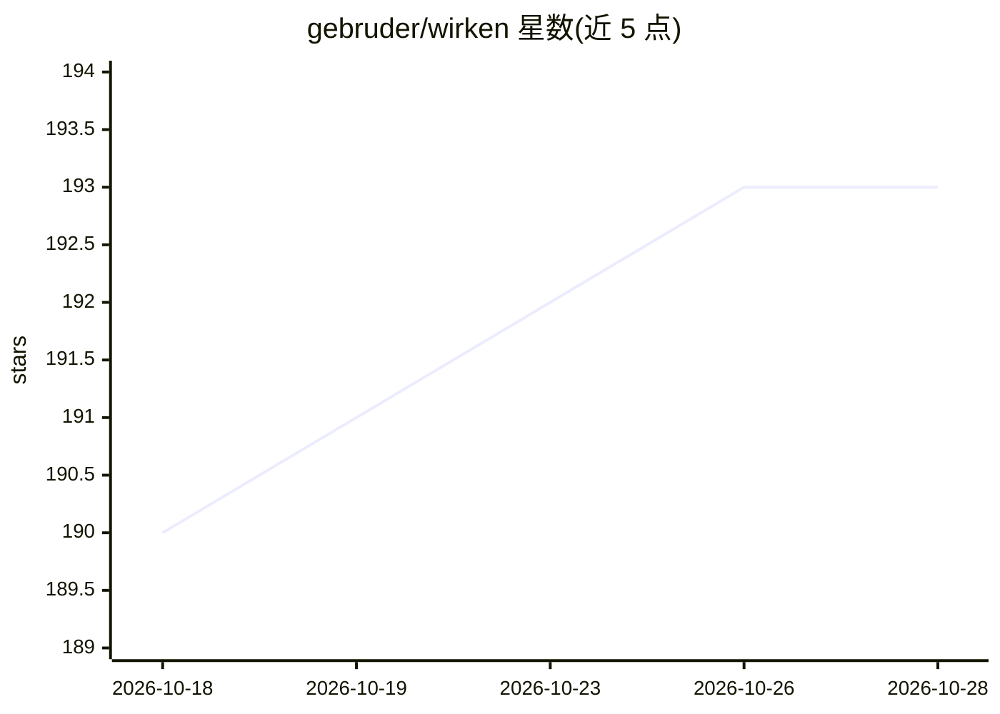

# gebruder/wirken

⭐ 193 · Rust · MIT · 推送 2026-10-27 · [GitHub](https://github.com/gebruder/wirken) · [官网](https://wirken.ai) · 组织维护

**企业级自主 agent 网关：通道隔离、凭据金库与审计日志**

以单一静态 Rust 二进制交付的自主 agent 网关：把团队消息通道（Telegram/Discord/Slack/Teams/Matrix 等）与代理 AI 连接起来，代理替用户读文件、调 API、跑工具。安全机制包括：凭据保存在加密金库且模型不可见、执行前写入签名哈希链审计日志、三级权限模型、shell 命令在无网络的一次性容器沙箱执行、每个通道独立进程。模型连接 provider 无关，支持前沿 API、Ollama 本地权重、TEE 等，按代理设支出预算。README 另列出网络出口未完全受限、沙箱可关闭等已知限制。

## 筛选速览

| 维度 | 判定 | 备注 |
|---|---|---|
| AI 角色 | `ai-ecosystem` | LLM/agent 周边工具 |
| 许可风险 | `permissive` | MIT |
| 部署形态 | `None` |  |
| 模型依赖 | local-ok | 支持本地模型 |
| 硬件要求 | — | 无带数字的原话,不猜 |
| 安装摩擦 | `low` | 无编译、无系统依赖或容器化 |
| 成熟度 | — | 结构信号不足 |

## 能力要点

- 凭据边缘注入：令牌与密钥存于加密金库，agent 与 LLM 不可见
- 动作执行前写入签名哈希链审计日志并归因到人
- shell 命令在无网络一次性容器中执行，沙箱不可用则拒绝执行
- 单一静态 Rust 二进制，Linux/macOS/Windows 11 预编译产物，模型连接 provider 无关（含 Ollama 本地权重）

## 适用场景

- 让团队从现有聊天平台使用 AI 代理并满足安全合规要求
- 控制被入侵代理的影响范围（凭据隔离、沙箱、权限分级）
- 向 SIEM/OpenTelemetry 导出代理操作的防篡改审计链

## 场景标签

`模型网关` `Agent 框架` · 领域:Agent 开发

## 证据(README 行号)

> L7: Wirken is the enterprise gateway for autonomous agents: the switchboard
> L26: A message comes in on a channel, Wirken wakes an agent to handle it, and every
> L81: `wirken run` spawns adapter processes, accepts authenticated connections,

## 星数曲线

2026-10-18 190 → 2026-10-28 193（+3）

---
*卡片 v1 · prompt 1.4 · 生成 2026-10-22 · 置信度 high · 依据 README sha `5d3424e08677` · [字段定义](../../DATASET.md)*
