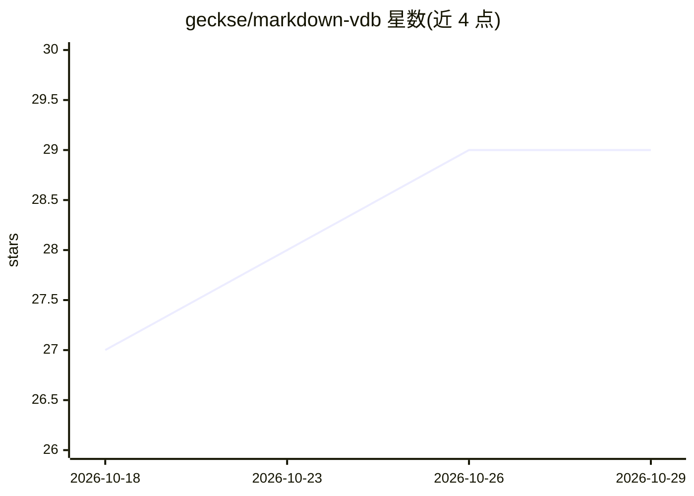

# geckse/markdown-vdb

⭐ 29 · Rust · MIT · 推送 2026-08-14 · [GitHub](https://github.com/geckse/markdown-vdb) · 个人维护

**面向 Markdown 的文件系统原生向量数据库，供 AI 代理检索**

用 Rust 编写的、围绕 Markdown 文件的文件系统原生向量数据库，无服务器、无容器，全部数据在磁盘上。提供混合（语义+BM25 经 RRF 融合）、语义、词法三种搜索模式，段落级结果、frontmatter 过滤、链接图（links/backlinks/orphans）、指数时间衰减、自动聚类、文件监听重索引等能力。面向需要本地知识库检索与代理记忆的 AI 代理、RAG 流水线及个人 Zettelkasten 用户。嵌入模型可选 OpenAI/OpenRouter/Gemini/Ollama 等。CLI 优先，同时提供 Rust 库 API，需从源码用 cargo 构建安装（要求 Rust 1.70+）。README 自述仍处开发阶段，建议等待 0.2.0 发布。

## 筛选速览

| 维度 | 判定 | 备注 |
|---|---|---|
| AI 角色 | `ai-ecosystem` | LLM/agent 周边工具 |
| 许可风险 | `permissive` | MIT |
| 部署形态 | `library` | 以包/库形式分发 |
| 模型依赖 | local-ok | 支持本地模型 |
| 硬件要求 | — | 无带数字的原话,不猜 |
| 安装摩擦 | `low` | 无编译、无系统依赖或容器化 |
| 成熟度 | `idea` | |

## 能力要点

- 混合/语义/词法三种搜索模式（RRF 融合，单内存映射索引，宣称查询低于 100ms）
- 链接图：links/backlinks/orphans 命令与 --boost-links 链接感知重排
- --decay 指数时间衰减与 frontmatter 过滤、命名 Shard、自动 Leiden 聚类
- 模型无关嵌入：OpenAI/OpenRouter/Gemini/Azure/Bedrock/Hugging Face/Ollama 或任意 OpenAI 兼容端点

## 适用场景

- 为 AI 代理构建本地知识库检索与两层记忆（日志+主题文件）
- 作为 RAG 流水线的检索层，JSON 输出接入 LLM 工具链
- 对 Obsidian/Logseq/普通文件夹做语义搜索且不修改笔记
- 文档站点建立随写随更新的搜索索引

## 场景标签

`向量数据库` `语义搜索` · 领域:知识与检索

## 证据(README 行号)

> L13: Three search modes out of the box: **hybrid** (semantic + lexical, fused via RRF), **semantic** (embedding similari
> L23: |**RAG Pipelines**|Drop-in retrieval layer for retrieval-augmented generation. JSON output (`--json`) pipes directl

## 星数曲线

2026-10-18 27 → 2026-10-29 29（+2）

---
*卡片 v1 · prompt 1.4 · 生成 2026-10-26 · 置信度 high · 依据 README sha `6b7311596a4c` · [字段定义](../../DATASET.md)*
