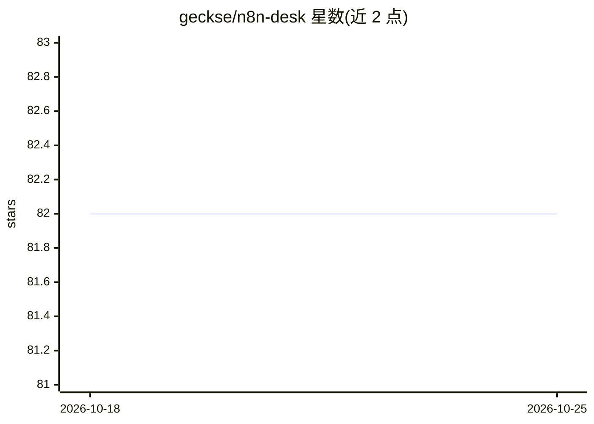

# geckse/n8n-desk

⭐ 82 · TypeScript · NOASSERTION · 推送 2026-07-08 · [GitHub](https://github.com/geckse/n8n-desk) · [官网](https://n8n-desk.app) · 个人维护

**n8n 的桌面/移动伴侣应用：对话式触发与编排 n8n 工作流**

面向 n8n 用户的开源跨平台伴侣应用（Electron 桌面 + Capacitor 移动），提供三种模式：Chat（路由消息至 n8n Chat Hub 代理）、Cowork（本地规划代理调用既有 n8n 工作流处理本地文件）、Workflow（经 n8n 官方 MCP server 对话式构建/校验/发布工作流）。代理运行时基于 Claude Agent SDK 与 Deep Agents（LangChain），支持 Ollama 本地模型与 OpenAI 兼容端点；不本地执行任意代码，审计经由 n8n 日志。当前处于 pre-release，无可用安装包，需加入等待列表获取 alpha。许可为 Sustainable Use License（n8n 系非 OSI 许可）。

## 筛选速览

| 维度 | 判定 | 备注 |
|---|---|---|
| AI 角色 | `ai-ecosystem` | LLM/agent 周边工具 |
| 许可风险 | `none` | NOASSERTION |
| 部署形态 | `desktop` | 安装包/桌面程序 |
| 模型依赖 | local-ok | 支持本地模型 |
| 硬件要求 | — | 无带数字的原话,不猜 |
| 安装摩擦 | `low` | 无编译、无系统依赖或容器化 |
| 成熟度 | `idea` | |

## 能力要点

- Chat/Cowork/Workflow 三模式，桌面全支持、移动端仅 Chat
- 通过 n8n 官方 MCP server 对话式构建与管理工作流
- 支持 Anthropic SDK、LangChain 兼容模型及 Ollama 本地离线运行
- 无本地代码执行，代理操作经由 n8n 工作流与沙箱化文件访问

## 适用场景

- 用对话代替可视化编辑器触发和构建 n8n 工作流
- 让代理在本地文件夹上批处理文档、生成报告
- 团队成员在移动端使用既有 Chat Hub 代理

## 场景标签

`工作流自动化` `AI 助手` · 领域:效率与自动化

## 证据(README 行号)

> L60: **n8n-desk closes that gap.** It's a desktop-native (and mobile-ready) companion app
> L128: |**Official n8n MCP**|Direct integration via n8n's Model Context Protocol server for workflow management.|
> L177: n8n-desk uses the Model Context Protocol to give

## 星数曲线

2026-10-18 82 → 2026-10-25 82（+0）

---
*卡片 v1 · prompt 1.4 · 生成 2026-10-24 · 置信度 high · 依据 README sha `aed0ac64f677` · [字段定义](../../DATASET.md)*
