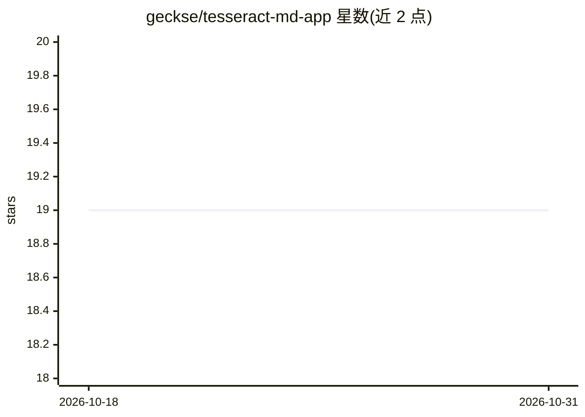

# geckse/tesseract-md-app

⭐ 19 · TypeScript · MIT · 推送 2026-08-19 · [GitHub](https://github.com/geckse/tesseract-md-app) · [官网](https://tesseract.md) · 个人维护

**本地优先的 Markdown 知识库桌面应用，含 3D 图谱与混合搜索**

基于 Electron + Svelte 5 的开源桌面知识库应用：以纯 Markdown 文件为载体，提供 Notion 风格块编辑器（TipTap）、CodeMirror 源码模式、wikilinks 与反向链接、多标签分栏与多窗口。检索与图谱能力委托给 Rust 编写的 mdvdb CLI（HNSW 向量索引 + BM25 全文 + RRF 融合 + 链接图分析 + K-means 聚类），支持语义/词法/混合三模式搜索与 frontmatter 过滤，CLI 输出 JSON 可供 AI agent 工作流使用。全部数据本地存储，语义索引需自选 OpenAI 或 Ollama 作为嵌入提供方；macOS 为正式版，Windows/Linux 处于 beta。

## 筛选速览

| 维度 | 判定 | 备注 |
|---|---|---|
| AI 角色 | `ai-enhanced` | 去掉 AI 部分产品仍成立 |
| 许可风险 | `permissive` | MIT |
| 部署形态 | `desktop` | 安装包/桌面程序 |
| 模型依赖 | local-ok | 支持本地模型 |
| 硬件要求 | — | 无带数字的原话,不猜 |
| 安装摩擦 | `low` | 无编译、无系统依赖或容器化 |
| 成熟度 | `idea` | |

## 能力要点

- mdvdb（Rust）驱动的语义+词法混合搜索与 HNSW 向量索引
- WebGL 交互式 3D 知识图谱，自动聚类与自动推断文档关系
- 三种编辑模式：CodeMirror 源码、TipTap WYSIWYG 块编辑、Mermaid 预览
- mdvdb CLI 输出 JSON，面向脚本与 AI agent 集成

## 适用场景

- 把 Markdown 笔记库变成可按语义搜索的本地知识库
- 通过 3D 图谱可视化和多跳遍历探索笔记间关系
- 在本地安全地管理多个知识库集合，无云同步无账号
- 用 mdvdb CLI 从终端索引、搜索并接入 agent 工作流

## 场景标签

`知识库管理` `语义搜索` `知识图谱` · 领域:知识与检索

## 证据(README 行号)

> L15: Tesseract is an open-source desktop app for building and exploring knowledge bases. Write in Markdown, link your id
> L17: Under the hood, Tesseract is powered by **mdvdb** — a state-of-the-art, ultra-performant Rust-based vector database
> L148: - **OpenAI** stores the API key in your user config at `~/.mdvdb/config`.

## 星数曲线

2026-10-18 19 → 2026-10-31 19（+0）

---
*卡片 v1 · prompt 1.4 · 生成 2026-10-28 · 置信度 high · 依据 README sha `03665b453674` · [字段定义](../../DATASET.md)*
