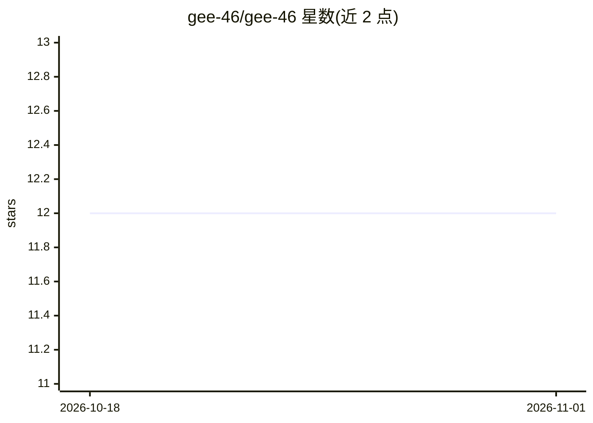

# gee-46/gee-46

⭐ 12 · 推送 2026-10-31 · [GitHub](https://github.com/gee-46/gee-46) · 个人维护

**个人开发者主页 README：AI 工程方向的求职与作品展示**

Gautam N Chipkar（SGBIT 在读 AI & Data Science 学生）的个人 GitHub Profile README，展示身份介绍、在 Samruddhi Organics 实习开发的 NutriPalm AI 精准农业平台、四个项目（SlumSafe AI、HarborPulse、Disaster VQA、手势音量控制）、技术栈表（PyTorch/FastAPI/Ollama 等）、竞赛成绩与 Microsoft 认证，并声明寻找远程 AI/ML 工程师岗位。不含可安装的软件产品。

## 筛选速览

| 维度 | 判定 | 备注 |
|---|---|---|
| AI 角色 | `ai-knowledge` | 知识聚合/清单类 |
| 许可风险 | `none` | — |
| 部署形态 | `None` |  |
| 模型依赖 | — | README 未给出锁定关系 |
| 硬件要求 | — | 无带数字的原话,不猜 |
| 安装摩擦 | `low` | 无编译、无系统依赖或容器化 |
| 成熟度 | — | 结构信号不足 |

## 能力要点

- 个人简介与求职意向（远程 AI/ML 岗位）
- 4 个项目条目介绍（城市安全、港口调度、灾害 VQA、手势控制）
- 技术栈清单覆盖 PyTorch、FastAPI、OpenCV、Ollama 等

## 适用场景

- 了解该开发者的技能与项目经历
- 招聘方或协作方通过 README 联系与评估候选人

## 场景标签

 · 领域:个人主页/职业展示

## 证据(README 行号)

> L5: # Gautam N Chipkar
> L36: ## 🚀 Featured Projects

## 星数曲线

2026-10-18 12 → 2026-11-01 12（+0）

---
*卡片 v1 · prompt 1.4 · 生成 2026-11-01 · 置信度 high · 依据 README sha `8892a8f9ad99` · [字段定义](../../DATASET.md)*
