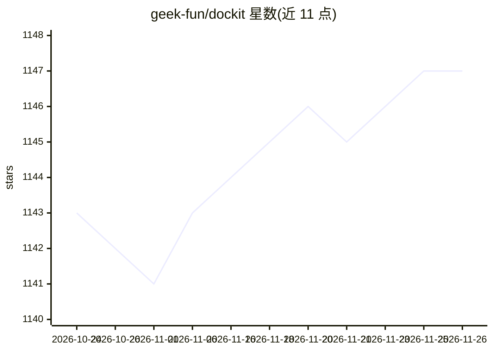

# geek-fun/dockit

⭐ 1,147 · TypeScript · Apache-2.0 · 推送 2026-11-25 · [GitHub](https://github.com/geek-fun/dockit) · [官网](https://www.geekfun.club/products/dockit/) · 组织维护 · 中文 README

**开发者的一体化 NoSQL 数据库桌面 GUI 客户端，支持自然语言查询**

面向开发者的开源桌面 GUI 客户端，统一管理 Elasticsearch、OpenSearch、DynamoDB、MongoDB 与 EasySearch 连接。核心功能包括 Monaco 编辑器、可视化查询构建器、集群管理与监控、查询历史、导入导出、无遥测本地存储。AI 部分以自带 LLM key 的方式提供：Agent 生成查询、检查 schema、执行文档操作，属于 Ultimate 付费模式解锁；社区模式免费提供全部数据源连接与基础编辑功能。源码 Apache-2.0。

## 筛选速览

| 维度 | 判定 | 备注 |
|---|---|---|
| AI 角色 | `ai-enhanced` | 去掉 AI 部分产品仍成立 |
| 许可风险 | `permissive` | Apache-2.0 |
| 部署形态 | `library` | 以包/库形式分发 |
| 模型依赖 | local-ok | 支持本地模型 |
| 硬件要求 | — | 无带数字的原话,不猜 |
| 安装摩擦 | `low` | 无编译、无系统依赖或容器化 |
| 成熟度 | — | 结构信号不足 |

## 能力要点

- 单一桌面应用连接 Elasticsearch/OpenSearch/DynamoDB/MongoDB/EasySearch
- 自然语言生成 Elasticsearch DSL、PartiQL、MongoDB 查询（自带 LLM key）
- 破坏性操作确认门与凭据不暴露给 LLM 的安全机制
- 无遥测、本地存储、OS 钥匙串加密连接配置

## 适用场景

- 用一个客户端管理多种 NoSQL 数据库的日常查询与浏览
- 用自然语言生成并调试 Elasticsearch DSL 或 PartiQL 查询
- 集群迁移或备份场景下批量导入导出数据
- 离线环境下管理 DynamoDB Local 开发数据

## 场景标签

`数据分析` · 领域:效率与自动化

## 证据(README 行号)

> L5: **Open-source GUI client for Elasticsearch, OpenSearch, DynamoDB and MongoDB — one native desktop app for all your N
> L20: DocKit replaces browser consoles like Kibana and AWS Console with a single native desktop app. Describe what you ne
> L52: |AI — agent, NL2SQL, explain, optimize, one-click fix (bring your own LLM key)|✅|

## 星数曲线

2026-10-24 1,143 → 2026-11-26 1,147（+4）

---
*卡片 v1 · prompt 1.4 · 生成 2026-11-26 · 置信度 high · 依据 README sha `2cc939f4259a` · [字段定义](../../DATASET.md)*
