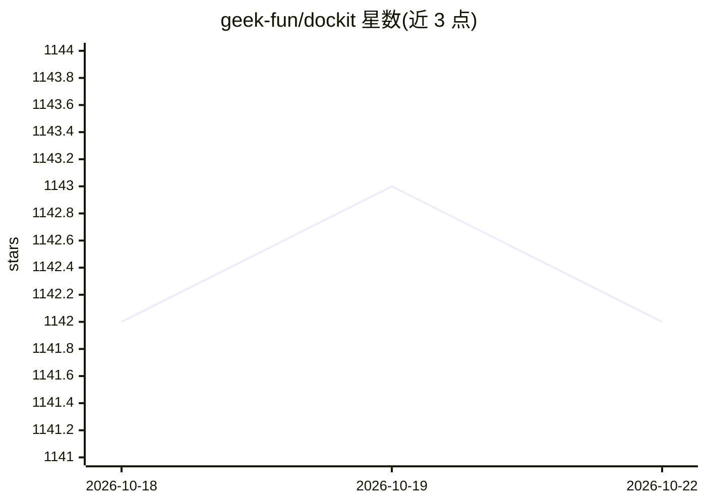

# geek-fun/dockit

⭐ 1,142 · TypeScript · Apache-2.0 · 推送 2026-10-22 · [GitHub](https://github.com/geek-fun/dockit) · [官网](https://www.geekfun.club/products/dockit/) · 组织维护 · 中文 README

**多 NoSQL 数据库的开源桌面 GUI 客户端，附自然语言 AI 代理**

基于 Tauri (Rust) + Vue 3 的原生桌面应用，统一管理 Elasticsearch、OpenSearch、DynamoDB、MongoDB 与 EasySearch：提供 Monaco 编辑器、可视化查询构建、集群管理与监控、查询历史（每连接 500 条本地存储）、JSON/CSV/JSONL 导入导出，强调隐私（无遥测、OS 钥匙串加密、可离线）。AI 部分为 Agentic Data Studio：自然语言生成 DSL/PartiQL/MongoDB 查询与 CRUD 操作，自带 LLM key 接入 OpenAI、Anthropic、DeepSeek、Ollama 等，属付费 Ultimate 模式（$9.9/月，源码 Apache-2.0）。

## 筛选速览

| 维度 | 判定 | 备注 |
|---|---|---|
| AI 角色 | `ai-enhanced` | 去掉 AI 部分产品仍成立 |
| 许可风险 | `permissive` | Apache-2.0 |
| 部署形态 | `library` | 以包/库形式分发 |
| 模型依赖 | local-ok | 支持本地模型 |
| 硬件要求 | — | 无带数字的原话,不猜 |
| 安装摩擦 | `low` | 无编译、无系统依赖或容器化 |
| 成熟度 | — | 结构信号不足 |

## 能力要点

- 单应用支持 Elasticsearch/OpenSearch/DynamoDB/MongoDB/EasySearch 五种数据源
- 自然语言生成 Elasticsearch DSL、PartiQL、MongoDB 查询（自带 LLM key）
- 无遥测、本地存储、OS 钥匙串加密、可完全离线运行
- 查询历史自动记录 500 条/连接，支持 JSON/CSV/JSONL 批量导入导出

## 适用场景

- 用一个桌面客户端替代多个浏览器控制台管理 NoSQL 数据库
- 用自然语言让 AI 代理写查询、改文档、建索引
- 离线或内网环境下安全地管理数据库连接与数据

## 场景标签

`数据分析` · 领域:效率与自动化

## 证据(README 行号)

> L5: **Open-source GUI client for Elasticsearch, OpenSearch, DynamoDB and MongoDB — one native desktop app for all your N
> L19: DocKit replaces browser consoles like Kibana and AWS Console with a single native desktop app. Describe what you ne

## 星数曲线

2026-10-18 1,142 → 2026-10-22 1,142（+0）

---
*卡片 v1 · prompt 1.4 · 生成 2026-10-21 · 置信度 mid · 依据 README sha `878cb843784c` · [字段定义](../../DATASET.md)*
