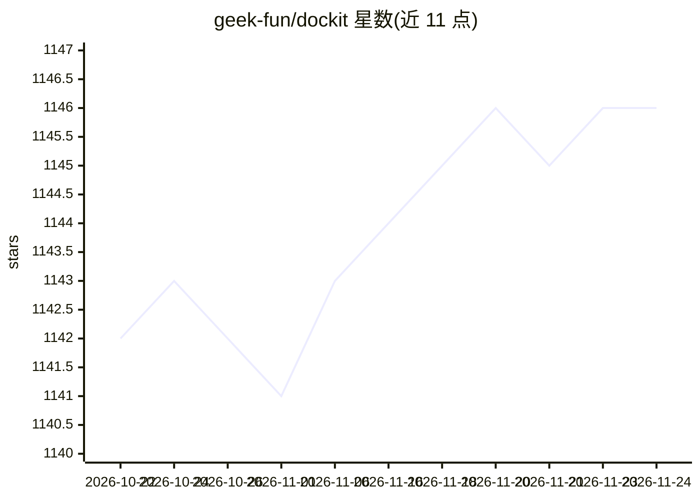

# geek-fun/dockit

⭐ 1,146 · TypeScript · Apache-2.0 · 推送 2026-11-22 · [GitHub](https://github.com/geek-fun/dockit) · [官网](https://www.geekfun.club/products/dockit/) · 组织维护 · 中文 README

**面向 NoSQL 开发者的多数据库桌面 GUI 客户端，支持自然语言查询**

基于 Tauri（Rust）+ Vue 3 的原生桌面应用，用一个客户端连接 Elasticsearch、OpenSearch、DynamoDB、MongoDB 与 EasySearch，替代浏览器控制台。提供 Monaco 编辑器、可视化查询构建器、集群管理与监控、查询历史、批量导入导出。AI 能力（自然语言生成查询、schema 检查、对话式 CRUD）属 Ultimate 付费模式，需自带 LLM key；社区版永久免费并覆盖全部数据源的基础功能。数据本地存储、无遥测。

## 筛选速览

| 维度 | 判定 | 备注 |
|---|---|---|
| AI 角色 | `ai-enhanced` | 去掉 AI 部分产品仍成立 |
| 许可风险 | `permissive` | Apache-2.0 |
| 部署形态 | `library` | 以包/库形式分发 |
| 模型依赖 | local-ok | 支持本地模型 |
| 硬件要求 | — | 无带数字的原话,不猜 |
| 安装摩擦 | `low` | 无编译、无系统依赖或容器化 |
| 成熟度 | — | 结构信号不足 |

## 能力要点

- 单一桌面客户端管理 Elasticsearch/OpenSearch/DynamoDB/MongoDB/EasySearch
- 自然语言生成 ES DSL、PartiQL、MongoDB 查询，含确认门与凭据不外泄机制
- Monaco 编辑器与可视化查询构建器，支持 500 条本地查询历史
- 无遥测、OS 钥匙串加密、可完全离线运行

## 适用场景

- 在桌面端统一管理多个 Elasticsearch/OpenSearch 集群
- 不用 AWS 控制台即可操作 DynamoDB 表与索引
- 本地离线开发（DynamoDB Local）与集群迁移、备份
- 用自然语言描述需求生成可运行查询

## 场景标签

`数据分析` · 领域:效率与自动化

## 证据(README 行号)

> L5: **Open-source GUI client for Elasticsearch, OpenSearch, DynamoDB and MongoDB — one native desktop app for all your N
> L52: |AI — agent, NL2SQL, explain, optimize, one-click fix (bring your own LLM key)|✅|

## 星数曲线

2026-10-22 1,142 → 2026-11-24 1,146（+4）

---
*卡片 v1 · prompt 1.4 · 生成 2026-11-24 · 置信度 high · 依据 README sha `2094b86fa068` · [字段定义](../../DATASET.md)*
