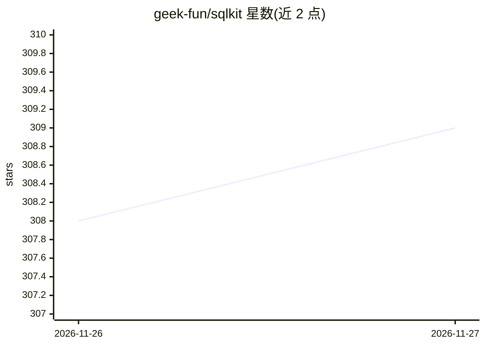

# geek-fun/sqlkit

⭐ 309 · Rust · Apache-2.0 · 推送 2026-11-26 · [GitHub](https://github.com/geek-fun/sqlkit) · [官网](https://www.geekfun.club/products/sqlkit/) · 组织维护 · 中文 README

**面向开发者的 70+ 数据库 AI 桌面 SQL 客户端与 GUI**

基于 Tauri v2（Rust）构建的跨平台数据库客户端，覆盖 PostgreSQL、MySQL、Oracle、SQLite、ClickHouse 等 70+ 数据库，采用原生驱动、PG/MySQL wire 兼容、JDBC 与 HTTP 四种适配策略。内置 AI 代理：自然语言生成 SQL、读取 schema、优化慢查询、解释执行计划、自动修复 SQL 错误，支持 OpenAI/Anthropic/DeepSeek/Ollama 自带密钥。社区版（Apache 2.0）免费提供连接、SQL 编辑、schema 浏览等；AI 代理、MCP server、跨引擎数据传输等属付费订阅功能。

## 筛选速览

| 维度 | 判定 | 备注 |
|---|---|---|
| AI 角色 | `ai-enhanced` | 去掉 AI 部分产品仍成立 |
| 许可风险 | `permissive` | Apache-2.0 |
| 部署形态 | `desktop` | 安装包/桌面程序 |
| 模型依赖 | local-ok | 支持本地模型 |
| 硬件要求 | — | 无带数字的原话,不猜 |
| 安装摩擦 | `low` | 无编译、无系统依赖或容器化 |
| 成熟度 | — | 结构信号不足 |

## 能力要点

- 自然语言到 SQL 的代理式生成、优化与错误修复
- 70+ 数据库支持，四种适配策略（原生/wire 兼容/JDBC/HTTP）
- Monaco 编辑器、schema 浏览、查询历史与结果导出
- 跨引擎大数据传输与 SSH 隧道、OS 钥匙串加密存储

## 适用场景

- 用自然语言对多种数据库编写和优化查询
- 在一个桌面应用中管理 70+ 种数据库连接
- 在不同数据库引擎间迁移数据而无需中间文件

## 场景标签

`数据分析` · 领域:效率与自动化

## 证据(README 行号)

> L26: SqlKit is an **agentic database client** — it doesn't just execute SQL, it understands your databases and acts on y
> L127: Describe what you need in natural language — the agent reads your schema, writes queries, optimizes slow SQL, expl
> L243: Advanced capabilities — AI agent (bring your own LLM), MCP server, ER diagrams, bulk import/export and cross-engin

## 星数曲线

2026-11-26 308 → 2026-11-27 309（+1）

---
*卡片 v1 · prompt 1.4 · 生成 2026-11-26 · 置信度 high · 依据 README sha `78706995b500` · [字段定义](../../DATASET.md)*
