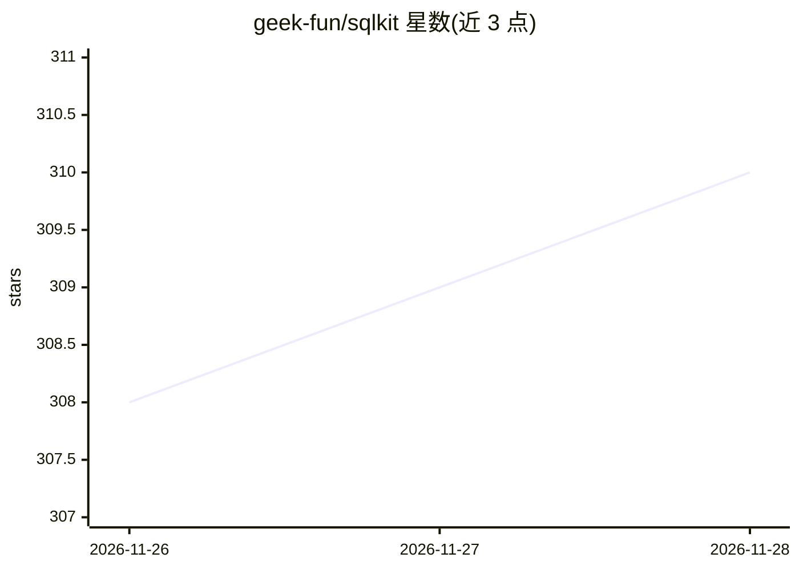

# geek-fun/sqlkit

⭐ 310 · Rust · Apache-2.0 · 推送 2026-11-27 · [GitHub](https://github.com/geek-fun/sqlkit) · [官网](https://www.geekfun.club/products/sqlkit/) · 组织维护 · 中文 README

**面向开发者的 AI SQL 客户端，支持 70+ 数据库**

基于 Tauri（Rust）的跨平台 SQL 数据库 GUI 客户端，覆盖 macOS、Windows、Linux，宣称支持 70+ 数据库（含 PostgreSQL、MySQL、Oracle、达梦、OceanBase 等），按原生驱动、PG/MySQL wire 兼容、JDBC、HTTP 四种适配策略接入。内置 AI Agent：自然语言生成 SQL、慢查询优化、执行计划解释、错误修复，密钥由用户自带，破坏性操作需确认。通过 MCP 服务器（@geek-fun/data-studio-mcp）向 Claude Code、Cursor 等 MCP 客户端暴露数据库工具。社区版免费开源，AI Agent、MCP 服务器等功能属付费订阅。无遥测，可离线使用。

## 筛选速览

| 维度 | 判定 | 备注 |
|---|---|---|
| AI 角色 | `ai-enhanced` | 去掉 AI 部分产品仍成立 |
| 许可风险 | `permissive` | Apache-2.0 |
| 部署形态 | `desktop` | 安装包/桌面程序 |
| 模型依赖 | local-ok | 支持本地模型 |
| 硬件要求 | — | 无带数字的原话,不猜 |
| 安装摩擦 | `low` | 无编译、无系统依赖或容器化 |
| 成熟度 | — | 结构信号不足 |

## 能力要点

- 支持 70+ 数据库，含四种适配策略（原生 Rust/wire 兼容/JDBC/HTTP）
- AI Agent 支持自然语言转 SQL、优化、错误修复，支持 OpenAI/Anthropic/DeepSeek/Ollama，自带密钥
- 内置 MCP 服务器，可被 Claude Code、Cursor 等 MCP 客户端接入，提供细粒度权限控制
- Rust+Tauri 构建的原生桌面应用，无 Electron/JRE，凭据经操作系统密钥链加密存储

## 适用场景

- 用一个桌面客户端管理多种数据库的连接与查询
- 用自然语言让 Agent 生成和优化 SQL
- 在 Claude Code/Cursor 等 MCP 客户端中操作本地数据库
- 跨数据库引擎迁移数据（如 PostgreSQL 到 ClickHouse）

## 场景标签

`数据分析` · 领域:效率与自动化

## 证据(README 行号)

> L26: SqlKit is an **agentic database client** — it doesn't just execute SQL, it understands your databases and acts on y
> L148: Describe what you need in natural language — the agent reads your schema, writes queries, optimizes slow SQL, expl
> L262: Yes — the **Community edition** is free and open source under the Apache 2.0 license. Connections, SQL editing, sc

## 星数曲线

2026-11-26 308 → 2026-11-28 310（+2）

---
*卡片 v1 · prompt 1.4 · 生成 2026-11-28 · 置信度 mid · 依据 README sha `99ca422e7840` · [字段定义](../../DATASET.md)*
